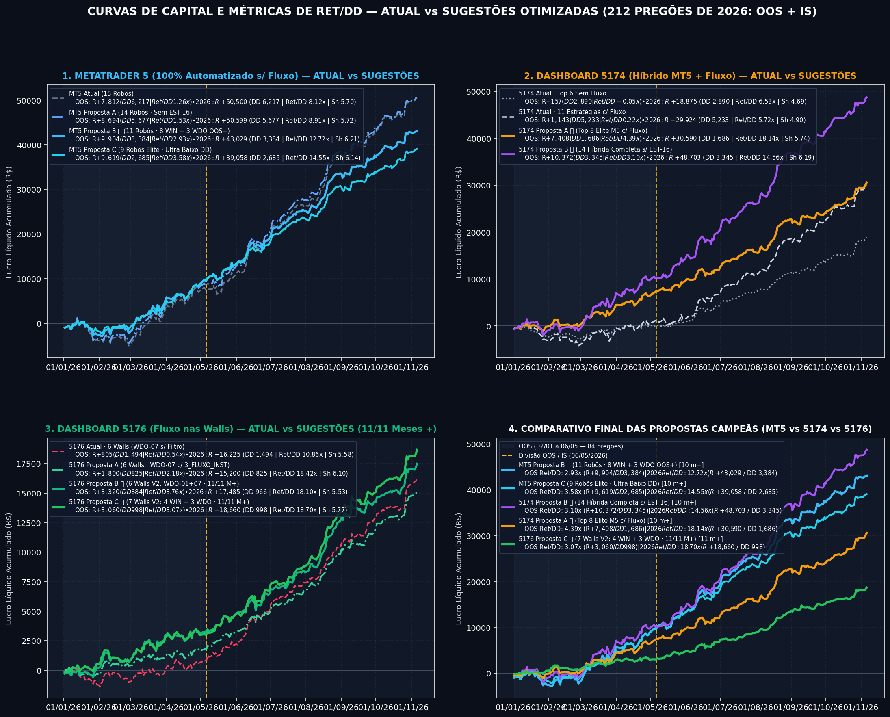
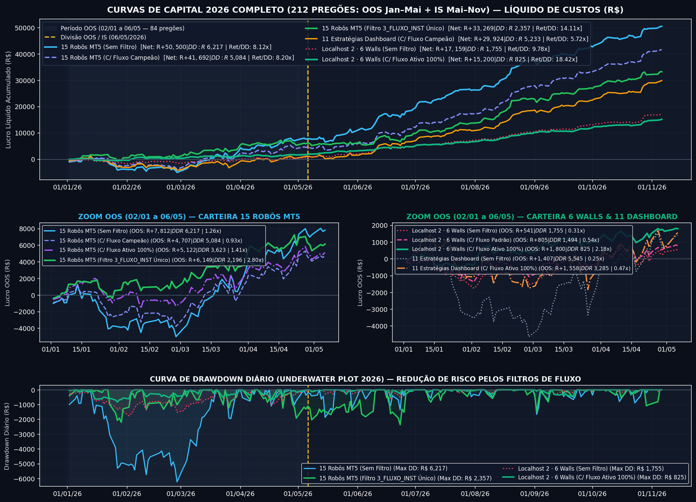
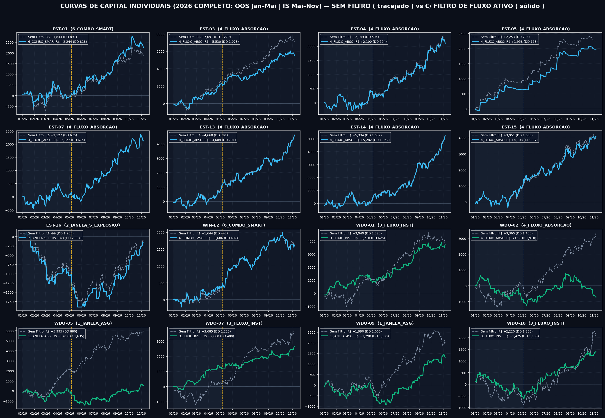

# Backtest de Longo Prazo 2026 (OOS vs IS vs TOTAL) — Estratégias de Fluxo nas Walls & Janela A.S.G (Dashboard)

- **Base de Dados:** 212 pregões completos de 2026 (`02/01/2026` a `06/11/2026`) com GEX B3 + Sessões Históricas de Fluxo Institucional/Varejo reconstruídas tick-a-tick (`.tkc` do MT5 `WIN$N` e `WDO$N`) em `data/processed/gex_historical_sessions_v1/`.
- **Divisão de Períodos:**
  1. **OUT-OF-SAMPLE (OOS):** `02/01/2026` a `06/05/2026` (**84 pregões** novos de backfill B3 + ticks MT5, 100% fora da amostra).
  2. **IN-SAMPLE (IS):** `07/05/2026` a `06/11/2026` (**128 pregões** originais).
  3. **PERÍODO TOTAL 2026:** `02/01/2026` a `06/11/2026` (**212 pregões**).
- **Custos Operacionais Incluídos:** `WIN = 10 pts/contrato (R$ 2,00/lote)` | `WDO = 0,5 pt/contrato (R$ 5,00/lote)`.

## 0. Curvas de Capital 2026 (OOS `02/01`–`06/05` vs. IS `07/05`–`06/11` e Drawdown Diário)

### A) Comparativo Atual vs. Sugestões Otimizadas (`MT5` · `Dashboard 5174` · `Dashboard 5176`)

### B) Carteiras Consolidadas (Ano Completo 2026, Zoom no OOS e Underwater Drawdown)

### C) Grid Individual das 16 Estratégias (`Sem Filtro` vs. `Com Filtro de Fluxo Ativo`)

## 1. OUT-OF-SAMPLE (OOS: 02/01/2026 a 06/05/2026 — 84 Pregões)

### A) Carteiras do Dashboard (Sem Filtro vs. Com Filtro de Fluxo)

| Carteira | Descrição | Trades | Lotes | WR (%) | PF Líq. | PF Bruto | Lucro Líq. (R$) | Lucro Bruto (R$) | Max DD Dia (R$) | Max DD Trade (R$) | Ret/DD | Payoff | Méd/Trade (R$) | Sharpe | % Dias + | Pior Dia (R$) | Melhor Dia (R$) | Max Streak |
| :--- | :--- | :---: | :---: | :---: | :---: | :---: | :---: | :---: | :---: | :---: | :---: | :---: | :---: | :---: | :---: | :---: | :---: | :---: |
| **PORTFOLIO_WALLS_6_BASE** | Localhost 2 · 6 Walls (4 WIN + 2 WDO) SEM Filtro | 1133 | 1323 | 46.9% | **1.02** | 1.13 | **R$ +541** | R$ +4,240 | R$ 1,755 | R$ 1,779 | **0.31x** | 1.13 | R$ +0.48 | **0.45** | 53.6% | R$ -624 | R$ +400 | 12 |
| **PORTFOLIO_WALLS_6_FLOW** | Localhost 2 · 6 Walls (4 WIN + 2 WDO) C/ FLUXO CAMPEÃO | 1056 | 1246 | 47.1% | **1.03** | 1.15 | **R$ +805** | R$ +4,137 | R$ 1,494 | R$ 1,792 | **0.54x** | 1.13 | R$ +0.76 | **0.70** | 58.3% | R$ -524 | R$ +387 | 12 |
| **PORTFOLIO_WALLS_6_STRICT** | Localhost 2 · 6 Walls (4 WIN + 2 WDO) C/ FLUXO ATIVO 100% | 909 | 1099 | 46.6% | **1.07** | 1.19 | **R$ +1,800** | R$ +4,397 | R$ 825 | R$ 951 | **2.18x** | 1.21 | R$ +1.98 | **1.91** | 58.3% | R$ -532 | R$ +401 | 12 |
| **PORTFOLIO_TOP_6_BASE** | Top 6 Campeãs (3 WIN + 3 WDO) SEM Filtro | 1251 | 1441 | 47.2% | **1.00** | 1.12 | **R$ -157** | R$ +4,651 | R$ 2,890 | R$ 3,123 | **-0.05x** | 1.09 | R$ -0.13 | **-0.10** | 50.0% | R$ -638 | R$ +721 | 12 |
| **PORTFOLIO_TOP_6_FLOW** | Top 6 Campeãs (3 WIN + 3 WDO) C/ FLUXO CAMPEÃO | 1178 | 1368 | 47.5% | **1.00** | 1.12 | **R$ +111** | R$ +4,560 | R$ 2,650 | R$ 2,862 | **0.04x** | 1.08 | R$ +0.09 | **0.07** | 51.2% | R$ -604 | R$ +646 | 12 |
| **PORTFOLIO_TOP_6_STRICT** | Top 6 Campeãs (3 WIN + 3 WDO) C/ FLUXO ATIVO 100% | 850 | 1040 | 46.2% | **1.01** | 1.13 | **R$ +376** | R$ +3,185 | R$ 927 | R$ 1,226 | **0.41x** | 1.15 | R$ +0.44 | **0.32** | 53.6% | R$ -724 | R$ +480 | 12 |
| **PORTFOLIO_ALL_11_BASE** | Carteira Dashboard 11 Estratégias (7 WIN + 4 WDO) SEM Filtro | 2220 | 2868 | 47.1% | **1.02** | 1.14 | **R$ +1,407** | R$ +9,489 | R$ 5,545 | R$ 5,859 | **0.25x** | 1.13 | R$ +0.63 | **0.53** | 54.8% | R$ -1,317 | R$ +1,106 | 23 |
| **PORTFOLIO_ALL_11_FLOW** | Carteira Dashboard 11 Estratégias (7 WIN + 4 WDO) C/ FLUXO CAMPEÃO | 2036 | 2682 | 47.4% | **1.02** | 1.14 | **R$ +1,143** | R$ +8,445 | R$ 5,233 | R$ 5,322 | **0.22x** | 1.11 | R$ +0.56 | **0.46** | 56.0% | R$ -1,273 | R$ +1,051 | 22 |
| **PORTFOLIO_ALL_11_STRICT** | Carteira Dashboard 11 Estratégias (7 WIN + 4 WDO) C/ FLUXO ATIVO 100% | 1707 | 2353 | 46.7% | **1.03** | 1.15 | **R$ +1,558** | R$ +7,218 | R$ 3,285 | R$ 3,361 | **0.47x** | 1.16 | R$ +0.91 | **0.70** | 54.8% | R$ -1,345 | R$ +712 | 17 |
| **PORTFOLIO_ALL_15_BASE** | Carteira MT5 15 Robôs (9 WIN + 6 WDO) SEM Filtro | 3687 | 4335 | 50.0% | **1.07** | 1.21 | **R$ +7,812** | R$ +20,850 | R$ 6,217 | R$ 7,064 | **1.26x** | 1.06 | R$ +2.12 | **2.10** | 57.1% | R$ -1,387 | R$ +1,931 | 17 |
| **PORTFOLIO_ALL_15_FLOW** | Carteira MT5 15 Robôs (9 WIN + 6 WDO) C/ FLUXO CAMPEÃO | 3062 | 3708 | 49.4% | **1.05** | 1.18 | **R$ +4,707** | R$ +14,916 | R$ 5,084 | R$ 5,320 | **0.93x** | 1.07 | R$ +1.54 | **1.47** | 57.1% | R$ -1,277 | R$ +1,546 | 18 |
| **PORTFOLIO_ALL_15_STRICT** | Carteira MT5 15 Robôs (9 WIN + 6 WDO) C/ FLUXO ATIVO 100% | 2733 | 3379 | 49.2% | **1.07** | 1.20 | **R$ +5,122** | R$ +13,689 | R$ 3,623 | R$ 3,810 | **1.41x** | 1.09 | R$ +1.87 | **1.78** | 59.5% | R$ -1,313 | R$ +1,150 | 13 |
| **PORTFOLIO_ALL_16_BASE** | Todas 16 (15 MT5 + WIN-E2 Wall Gasta) SEM Filtro | 3860 | 4508 | 49.9% | **1.07** | 1.21 | **R$ +8,210** | R$ +21,594 | R$ 6,245 | R$ 7,092 | **1.31x** | 1.06 | R$ +2.13 | **2.21** | 57.1% | R$ -1,434 | R$ +1,933 | 17 |
| **PORTFOLIO_ALL_16_FLOW** | Todas 16 (15 MT5 + WIN-E2 Wall Gasta) C/ FLUXO CAMPEÃO | 3231 | 3877 | 49.3% | **1.06** | 1.18 | **R$ +5,101** | R$ +15,648 | R$ 5,066 | R$ 5,324 | **1.01x** | 1.07 | R$ +1.58 | **1.59** | 57.1% | R$ -1,277 | R$ +1,548 | 16 |
| **PORT_11_UNIFORM_1_JANELA_ASG** | 11 Estratégias c/ Filtro Único 1_JANELA_ASG | 1130 | 1398 | 42.3% | **0.91** | 1.01 | **R$ -3,364** | R$ +455 | R$ 4,007 | R$ 4,161 | **-0.84x** | 1.22 | R$ -2.98 | **-1.93** | 48.2% | R$ -969 | R$ +477 | 17 |
| **PORT_15_UNIFORM_1_JANELA_ASG** | 15 Estratégias c/ Filtro Único 1_JANELA_ASG | 1937 | 2205 | 46.6% | **0.95** | 1.07 | **R$ -2,840** | R$ +3,490 | R$ 5,781 | R$ 6,250 | **-0.49x** | 1.07 | R$ -1.47 | **-1.04** | 46.4% | R$ -1,293 | R$ +1,137 | 14 |
| **PORT_11_UNIFORM_2_JANELA_S_EXPLOSAO** | 11 Estratégias c/ Filtro Único 2_JANELA_S_EXPLOSAO | 1709 | 2137 | 45.3% | **1.03** | 1.15 | **R$ +1,734** | R$ +7,547 | R$ 4,180 | R$ 4,494 | **0.41x** | 1.23 | R$ +1.01 | **0.82** | 56.0% | R$ -1,051 | R$ +841 | 20 |
| **PORT_15_UNIFORM_2_JANELA_S_EXPLOSAO** | 15 Estratégias c/ Filtro Único 2_JANELA_S_EXPLOSAO | 2856 | 3284 | 49.2% | **1.07** | 1.21 | **R$ +5,798** | R$ +15,219 | R$ 4,201 | R$ 4,921 | **1.38x** | 1.09 | R$ +2.03 | **1.79** | 53.6% | R$ -1,128 | R$ +1,595 | 15 |
| **PORT_11_UNIFORM_3_FLUXO_INST** | 11 Estratégias c/ Filtro Único 3_FLUXO_INST | 1623 | 2187 | 46.5% | **1.03** | 1.15 | **R$ +1,528** | R$ +6,895 | R$ 2,831 | R$ 3,031 | **0.54x** | 1.17 | R$ +0.94 | **0.73** | 51.2% | R$ -1,113 | R$ +708 | 22 |
| **PORT_15_UNIFORM_3_FLUXO_INST** | 15 Estratégias c/ Filtro Único 3_FLUXO_INST | 2559 | 3123 | 48.9% | **1.09** | 1.22 | **R$ +6,149** | R$ +14,162 | R$ 2,196 | R$ 2,625 | **2.80x** | 1.13 | R$ +2.40 | **2.23** | 60.7% | R$ -1,239 | R$ +1,170 | 16 |
| **PORT_11_UNIFORM_4_FLUXO_ABSORCAO** | 11 Estratégias c/ Filtro Único 4_FLUXO_ABSORCAO | 1677 | 2325 | 46.3% | **1.02** | 1.13 | **R$ +1,056** | R$ +6,540 | R$ 4,514 | R$ 4,942 | **0.23x** | 1.17 | R$ +0.63 | **0.47** | 54.8% | R$ -1,335 | R$ +881 | 22 |
| **PORT_15_UNIFORM_4_FLUXO_ABSORCAO** | 15 Estratégias c/ Filtro Único 4_FLUXO_ABSORCAO | 2620 | 3268 | 48.5% | **1.05** | 1.17 | **R$ +3,795** | R$ +11,771 | R$ 4,679 | R$ 5,080 | **0.81x** | 1.11 | R$ +1.45 | **1.27** | 58.3% | R$ -1,673 | R$ +1,170 | 16 |
| **PORT_11_UNIFORM_5_COMBO_ESTRITO** | 11 Estratégias c/ Filtro Único 5_COMBO_ESTRITO | 859 | 1127 | 40.4% | **0.84** | 0.93 | **R$ -4,477** | R$ -1,914 | R$ 5,344 | R$ 5,451 | **-0.84x** | 1.22 | R$ -5.21 | **-3.06** | 43.4% | R$ -816 | R$ +465 | 16 |
| **PORT_15_UNIFORM_5_COMBO_ESTRITO** | 15 Estratégias c/ Filtro Único 5_COMBO_ESTRITO | 1403 | 1671 | 44.3% | **0.86** | 0.96 | **R$ -5,471** | R$ -1,586 | R$ 7,326 | R$ 7,507 | **-0.75x** | 1.07 | R$ -3.90 | **-2.78** | 45.2% | R$ -1,064 | R$ +612 | 14 |
| **PORT_11_UNIFORM_6_COMBO_SMART** | 11 Estratégias c/ Filtro Único 6_COMBO_SMART | 1317 | 1743 | 43.9% | **0.98** | 1.09 | **R$ -659** | R$ +3,304 | R$ 3,465 | R$ 3,891 | **-0.19x** | 1.24 | R$ -0.50 | **-0.38** | 52.4% | R$ -916 | R$ +611 | 19 |
| **PORT_15_UNIFORM_6_COMBO_SMART** | 15 Estratégias c/ Filtro Único 6_COMBO_SMART | 2089 | 2515 | 47.1% | **1.00** | 1.12 | **R$ +174** | R$ +6,023 | R$ 4,262 | R$ 4,673 | **0.04x** | 1.12 | R$ +0.08 | **0.08** | 54.8% | R$ -1,066 | R$ +739 | 14 |

### B) Comparação por Estratégia (Sem Filtro `0_BASE_MT5` vs. Filtro de Fluxo Ativo)

| Estratégia | Ativo | TF | Filtro Ativo Aplicado | Tr (Sem -> C/Fluxo) | WR% (Sem -> C/Fluxo) | PF Líq. (Sem -> C/Fluxo) | Lucro Líq. R$ (Sem -> C/Fluxo) | Max DD Dia R$ (Sem -> C/Fluxo) | Ret/DD (Sem -> C/Fluxo) | Sharpe (Sem -> C/Fluxo) |
| :--- | :---: | :---: | :--- | :---: | :---: | :---: | :---: | :---: | :---: | :---: |
| **EST-01** | WIN | M5 | `6_COMBO_SMART` | 352 -> **310** | 30.1% -> **29.0%** | 1.02 -> **1.01** | R$ +127 -> **R$ +99** | R$ 891 -> **R$ 818** | 0.14x -> **0.12x** | 0.21 -> **0.15** |
| **EST-03** | WIN | M15 | `4_FLUXO_ABSORCAO` | 704 -> **667** | 53.0% -> **52.5%** | 1.22 -> **1.20** | R$ +2,502 -> **R$ +2,158** | R$ 1,279 -> **R$ 1,073** | 1.96x -> **2.01x** | 3.22 -> **2.74** |
| **EST-04** | WIN | M5 | `4_FLUXO_ABSORCAO` | 177 -> **176** | 40.1% -> **40.3%** | 1.05 -> **1.06** | R$ +196 -> **R$ +246** | R$ 594 -> **R$ 594** | 0.33x -> **0.41x** | 0.49 -> **0.62** |
| **EST-05** | WIN | M15 | `4_FLUXO_ABSORCAO` | 89 -> **74** | 48.3% -> **47.3%** | 2.49 -> **2.20** | R$ +933 -> **R$ +641** | R$ 152 -> **R$ 148** | 6.14x -> **4.33x** | 4.08 -> **3.05** |
| **EST-07** | WIN | M5 | `4_FLUXO_ABSORCAO` | 226 -> **226** | 34.5% -> **34.5%** | 1.03 -> **1.03** | R$ +158 -> **R$ +158** | R$ 540 -> **R$ 540** | 0.29x -> **0.29x** | 0.33 -> **0.33** |
| **EST-13** | WIN | M5 | `4_FLUXO_ABSORCAO` | 208 -> **207** | 61.1% -> **60.9%** | 1.18 -> **1.17** | R$ +1,168 -> **R$ +1,116** | R$ 791 -> **R$ 791** | 1.48x -> **1.41x** | 1.72 -> **1.65** |
| **EST-14** | WIN | M5 | `4_FLUXO_ABSORCAO` | 206 -> **205** | 61.2% -> **61.0%** | 1.07 -> **1.06** | R$ +514 -> **R$ +462** | R$ 1,052 -> **R$ 1,052** | 0.49x -> **0.44x** | 0.68 -> **0.62** |
| **EST-15** | WIN | M5 | `4_FLUXO_ABSORCAO` | 199 -> **198** | 61.3% -> **61.6%** | 1.18 -> **1.21** | R$ +1,161 -> **R$ +1,311** | R$ 1,080 -> **R$ 997** | 1.07x -> **1.31x** | 1.71 -> **1.95** |
| **EST-16** | WIN | M5 | `2_JANELA_S_EXPLOSAO` | 70 -> **67** | 58.6% -> **58.2%** | 0.70 -> **0.65** | R$ -882 -> **R$ -1,014** | R$ 1,288 -> **R$ 1,399** | -0.68x -> **-0.72x** | -2.12 -> **-2.48** |
| **WIN-E2** | WIN | M5 | `6_COMBO_SMART` | 173 -> **169** | 48.0% -> **47.3%** | 1.13 -> **1.13** | R$ +398 -> **R$ +394** | R$ 306 -> **R$ 306** | 1.30x -> **1.29x** | 1.30 -> **1.32** |
| **WDO-01** | WDO | M5 | `3_FLUXO_INST` | 326 -> **127** | 50.6% -> **53.5%** | 1.08 -> **1.21** | R$ +915 -> **R$ +890** | R$ 1,325 -> **R$ 625** | 0.69x -> **1.42x** | 0.99 -> **1.54** |
| **WDO-02** | WDO | M5 | `4_FLUXO_ABSORCAO` | 291 -> **110** | 49.1% -> **44.5%** | 0.97 -> **0.80** | R$ -300 -> **R$ -1,030** | R$ 1,455 -> **R$ 1,725** | -0.21x -> **-0.60x** | -0.36 -> **-1.77** |
| **WDO-05** | WDO | M5 | `1_JANELA_ASG` | 348 -> **158** | 62.6% -> **60.1%** | 1.16 -> **0.98** | R$ +2,055 -> **R$ -125** | R$ 880 -> **R$ 1,295** | 2.34x -> **-0.10x** | 2.50 -> **-0.19** |
| **WDO-07** | WDO | M5 | `3_FLUXO_INST` | 214 -> **67** | 53.7% -> **62.7%** | 1.02 -> **1.72** | R$ +175 -> **R$ +1,170** | R$ 1,225 -> **R$ 305** | 0.14x -> **3.84x** | 0.26 -> **3.02** |
| **WDO-09** | WDO | M5 | `1_JANELA_ASG` | 140 -> **75** | 41.4% -> **37.3%** | 1.00 -> **0.89** | R$ -10 -> **R$ -330** | R$ 795 -> **R$ 805** | -0.01x -> **-0.41x** | -0.02 -> **-0.81** |
| **WDO-10** | WDO | M5 | `3_FLUXO_INST` | 137 -> **66** | 42.3% -> **42.4%** | 0.85 -> **0.80** | R$ -900 -> **R$ -630** | R$ 1,300 -> **R$ 1,135** | -0.69x -> **-0.56x** | -1.61 -> **-1.54** |

## 2. IN-SAMPLE (IS: 07/05/2026 a 06/11/2026 — 128 Pregões)

### A) Carteiras do Dashboard (Sem Filtro vs. Com Filtro de Fluxo)

| Carteira | Descrição | Trades | Lotes | WR (%) | PF Líq. | PF Bruto | Lucro Líq. (R$) | Lucro Bruto (R$) | Max DD Dia (R$) | Max DD Trade (R$) | Ret/DD | Payoff | Méd/Trade (R$) | Sharpe | % Dias + | Pior Dia (R$) | Melhor Dia (R$) | Max Streak |
| :--- | :--- | :---: | :---: | :---: | :---: | :---: | :---: | :---: | :---: | :---: | :---: | :---: | :---: | :---: | :---: | :---: | :---: | :---: |
| **PORTFOLIO_WALLS_6_BASE** | Localhost 2 · 6 Walls (4 WIN + 2 WDO) SEM Filtro | 1484 | 1732 | 52.5% | **1.49** | 1.67 | **R$ +16,618** | R$ +21,375 | R$ 631 | R$ 726 | **26.34x** | 1.31 | R$ +11.20 | **8.65** | 75.0% | R$ -419 | R$ +1,260 | 8 |
| **PORTFOLIO_WALLS_6_FLOW** | Localhost 2 · 6 Walls (4 WIN + 2 WDO) C/ FLUXO CAMPEÃO | 1394 | 1642 | 52.7% | **1.50** | 1.68 | **R$ +15,420** | R$ +19,745 | R$ 335 | R$ 683 | **46.03x** | 1.31 | R$ +11.06 | **9.23** | 75.0% | R$ -335 | R$ +945 | 8 |
| **PORTFOLIO_WALLS_6_STRICT** | Localhost 2 · 6 Walls (4 WIN + 2 WDO) C/ FLUXO ATIVO 100% | 1246 | 1494 | 52.4% | **1.49** | 1.66 | **R$ +13,400** | R$ +16,985 | R$ 479 | R$ 818 | **27.97x** | 1.34 | R$ +10.75 | **8.99** | 72.7% | R$ -479 | R$ +615 | 8 |
| **PORTFOLIO_TOP_6_BASE** | Top 6 Campeãs (3 WIN + 3 WDO) SEM Filtro | 1579 | 1827 | 52.4% | **1.45** | 1.64 | **R$ +19,032** | R$ +24,984 | R$ 976 | R$ 1,071 | **19.50x** | 1.28 | R$ +12.05 | **8.00** | 70.3% | R$ -570 | R$ +1,273 | 8 |
| **PORTFOLIO_TOP_6_FLOW** | Top 6 Campeãs (3 WIN + 3 WDO) C/ FLUXO CAMPEÃO | 1494 | 1742 | 52.6% | **1.46** | 1.64 | **R$ +17,868** | R$ +23,398 | R$ 664 | R$ 1,013 | **26.91x** | 1.27 | R$ +11.96 | **8.31** | 70.3% | R$ -640 | R$ +1,273 | 13 |
| **PORTFOLIO_TOP_6_STRICT** | Top 6 Campeãs (3 WIN + 3 WDO) C/ FLUXO ATIVO 100% | 1175 | 1423 | 51.8% | **1.42** | 1.59 | **R$ +12,503** | R$ +16,438 | R$ 597 | R$ 860 | **20.94x** | 1.30 | R$ +10.64 | **7.52** | 68.8% | R$ -404 | R$ +663 | 11 |
| **PORTFOLIO_ALL_11_BASE** | Carteira Dashboard 11 Estratégias (7 WIN + 4 WDO) SEM Filtro | 2892 | 3676 | 51.9% | **1.39** | 1.55 | **R$ +29,814** | R$ +40,010 | R$ 1,819 | R$ 1,993 | **16.39x** | 1.26 | R$ +10.31 | **8.06** | 71.9% | R$ -1,008 | R$ +1,712 | 11 |
| **PORTFOLIO_ALL_11_FLOW** | Carteira Dashboard 11 Estratégias (7 WIN + 4 WDO) C/ FLUXO CAMPEÃO | 2639 | 3419 | 52.9% | **1.42** | 1.59 | **R$ +28,781** | R$ +37,935 | R$ 1,544 | R$ 1,723 | **18.64x** | 1.24 | R$ +10.91 | **8.35** | 74.2% | R$ -916 | R$ +1,852 | 11 |
| **PORTFOLIO_ALL_11_STRICT** | Carteira Dashboard 11 Estratégias (7 WIN + 4 WDO) C/ FLUXO ATIVO 100% | 2317 | 3097 | 52.5% | **1.40** | 1.56 | **R$ +23,423** | R$ +30,976 | R$ 1,023 | R$ 1,311 | **22.90x** | 1.25 | R$ +10.11 | **7.66** | 69.5% | R$ -858 | R$ +1,242 | 12 |
| **PORTFOLIO_ALL_15_BASE** | Carteira MT5 15 Robôs (9 WIN + 6 WDO) SEM Filtro | 4786 | 5570 | 52.8% | **1.36** | 1.53 | **R$ +42,688** | R$ +59,000 | R$ 1,866 | R$ 2,355 | **22.88x** | 1.19 | R$ +8.92 | **8.52** | 71.9% | R$ -1,430 | R$ +2,227 | 11 |
| **PORTFOLIO_ALL_15_FLOW** | Carteira MT5 15 Robôs (9 WIN + 6 WDO) C/ FLUXO CAMPEÃO | 4031 | 4811 | 53.0% | **1.39** | 1.56 | **R$ +36,985** | R$ +50,066 | R$ 1,714 | R$ 2,130 | **21.58x** | 1.21 | R$ +9.18 | **8.73** | 73.4% | R$ -1,348 | R$ +2,148 | 10 |
| **PORTFOLIO_ALL_15_STRICT** | Carteira MT5 15 Robôs (9 WIN + 6 WDO) C/ FLUXO ATIVO 100% | 3709 | 4489 | 52.8% | **1.36** | 1.53 | **R$ +31,627** | R$ +43,107 | R$ 1,490 | R$ 1,697 | **21.23x** | 1.20 | R$ +8.53 | **8.36** | 70.3% | R$ -891 | R$ +1,767 | 12 |
| **PORTFOLIO_ALL_16_BASE** | Todas 16 (15 MT5 + WIN-E2 Wall Gasta) SEM Filtro | 5026 | 5810 | 52.7% | **1.36** | 1.53 | **R$ +43,934** | R$ +60,726 | R$ 1,637 | R$ 2,126 | **26.84x** | 1.20 | R$ +8.74 | **8.81** | 71.9% | R$ -1,353 | R$ +2,179 | 11 |
| **PORTFOLIO_ALL_16_FLOW** | Todas 16 (15 MT5 + WIN-E2 Wall Gasta) C/ FLUXO CAMPEÃO | 4266 | 5046 | 53.0% | **1.38** | 1.55 | **R$ +38,197** | R$ +51,748 | R$ 1,485 | R$ 1,913 | **25.72x** | 1.21 | R$ +8.95 | **9.06** | 72.7% | R$ -1,271 | R$ +2,100 | 10 |
| **PORT_11_UNIFORM_1_JANELA_ASG** | 11 Estratégias c/ Filtro Único 1_JANELA_ASG | 1491 | 1771 | 48.5% | **1.38** | 1.55 | **R$ +14,555** | R$ +19,456 | R$ 2,396 | R$ 2,563 | **6.07x** | 1.45 | R$ +9.76 | **5.04** | 65.6% | R$ -1,256 | R$ +1,088 | 16 |
| **PORT_15_UNIFORM_1_JANELA_ASG** | 15 Estratégias c/ Filtro Único 1_JANELA_ASG | 2571 | 2851 | 50.3% | **1.34** | 1.50 | **R$ +20,557** | R$ +28,674 | R$ 2,732 | R$ 3,020 | **7.52x** | 1.30 | R$ +8.00 | **5.00** | 62.5% | R$ -2,143 | R$ +1,533 | 12 |
| **PORT_11_UNIFORM_2_JANELA_S_EXPLOSAO** | 11 Estratégias c/ Filtro Único 2_JANELA_S_EXPLOSAO | 2235 | 2789 | 49.0% | **1.26** | 1.41 | **R$ +15,856** | R$ +23,387 | R$ 3,035 | R$ 3,150 | **5.22x** | 1.29 | R$ +7.09 | **5.27** | 65.6% | R$ -1,078 | R$ +1,202 | 12 |
| **PORT_15_UNIFORM_2_JANELA_S_EXPLOSAO** | 15 Estratégias c/ Filtro Único 2_JANELA_S_EXPLOSAO | 3765 | 4319 | 50.5% | **1.24** | 1.39 | **R$ +22,236** | R$ +34,435 | R$ 3,234 | R$ 3,325 | **6.88x** | 1.20 | R$ +5.91 | **5.40** | 62.5% | R$ -1,956 | R$ +1,728 | 11 |
| **PORT_11_UNIFORM_3_FLUXO_INST** | 11 Estratégias c/ Filtro Único 3_FLUXO_INST | 2263 | 2985 | 51.1% | **1.30** | 1.45 | **R$ +18,026** | R$ +25,520 | R$ 1,793 | R$ 2,073 | **10.05x** | 1.22 | R$ +7.97 | **5.54** | 63.3% | R$ -850 | R$ +1,399 | 12 |
| **PORT_15_UNIFORM_3_FLUXO_INST** | 15 Estratégias c/ Filtro Único 3_FLUXO_INST | 3673 | 4395 | 52.5% | **1.30** | 1.46 | **R$ +27,120** | R$ +38,745 | R$ 2,357 | R$ 2,571 | **11.51x** | 1.16 | R$ +7.38 | **6.19** | 67.2% | R$ -1,119 | R$ +2,492 | 11 |
| **PORT_11_UNIFORM_4_FLUXO_ABSORCAO** | 11 Estratégias c/ Filtro Único 4_FLUXO_ABSORCAO | 2322 | 3106 | 51.7% | **1.33** | 1.48 | **R$ +19,924** | R$ +27,441 | R$ 1,021 | R$ 1,385 | **19.51x** | 1.22 | R$ +8.58 | **6.23** | 62.5% | R$ -1,008 | R$ +1,241 | 10 |
| **PORT_15_UNIFORM_4_FLUXO_ABSORCAO** | 15 Estratégias c/ Filtro Único 4_FLUXO_ABSORCAO | 3686 | 4470 | 52.5% | **1.32** | 1.48 | **R$ +28,058** | R$ +39,362 | R$ 1,554 | R$ 1,933 | **18.06x** | 1.18 | R$ +7.61 | **6.78** | 65.6% | R$ -1,321 | R$ +2,242 | 12 |
| **PORT_11_UNIFORM_5_COMBO_ESTRITO** | 11 Estratégias c/ Filtro Único 5_COMBO_ESTRITO | 1152 | 1426 | 48.2% | **1.39** | 1.54 | **R$ +10,729** | R$ +14,070 | R$ 1,122 | R$ 1,208 | **9.56x** | 1.49 | R$ +9.31 | **4.71** | 59.4% | R$ -805 | R$ +1,088 | 17 |
| **PORT_15_UNIFORM_5_COMBO_ESTRITO** | 15 Estratégias c/ Filtro Único 5_COMBO_ESTRITO | 1921 | 2195 | 50.5% | **1.39** | 1.55 | **R$ +15,857** | R$ +21,120 | R$ 1,402 | R$ 1,553 | **11.31x** | 1.35 | R$ +8.25 | **5.37** | 61.7% | R$ -800 | R$ +1,472 | 17 |
| **PORT_11_UNIFORM_6_COMBO_SMART** | 11 Estratégias c/ Filtro Único 6_COMBO_SMART | 1802 | 2348 | 49.4% | **1.29** | 1.43 | **R$ +13,557** | R$ +19,081 | R$ 1,333 | R$ 1,581 | **10.17x** | 1.31 | R$ +7.52 | **5.24** | 61.7% | R$ -836 | R$ +892 | 13 |
| **PORT_15_UNIFORM_6_COMBO_SMART** | 15 Estratégias c/ Filtro Único 6_COMBO_SMART | 2929 | 3475 | 51.2% | **1.30** | 1.45 | **R$ +20,185** | R$ +28,662 | R$ 1,552 | R$ 2,019 | **13.01x** | 1.23 | R$ +6.89 | **5.82** | 62.5% | R$ -810 | R$ +1,592 | 12 |

### B) Comparação por Estratégia (Sem Filtro `0_BASE_MT5` vs. Filtro de Fluxo Ativo)

| Estratégia | Ativo | TF | Filtro Ativo Aplicado | Tr (Sem -> C/Fluxo) | WR% (Sem -> C/Fluxo) | PF Líq. (Sem -> C/Fluxo) | Lucro Líq. R$ (Sem -> C/Fluxo) | Max DD Dia R$ (Sem -> C/Fluxo) | Ret/DD (Sem -> C/Fluxo) | Sharpe (Sem -> C/Fluxo) |
| :--- | :---: | :---: | :--- | :---: | :---: | :---: | :---: | :---: | :---: | :---: |
| **EST-01** | WIN | M5 | `6_COMBO_SMART` | 476 -> **407** | 34.0% -> **35.1%** | 1.17 -> **1.26** | R$ +1,717 -> **R$ +2,145** | R$ 447 -> **R$ 532** | 3.84x -> **4.03x** | 2.30 -> **2.83** |
| **EST-03** | WIN | M15 | `4_FLUXO_ABSORCAO` | 1009 -> **920** | 53.8% -> **53.7%** | 1.30 -> **1.24** | R$ +4,589 -> **R$ +3,372** | R$ 625 -> **R$ 775** | 7.34x -> **4.35x** | 3.68 -> **3.01** |
| **EST-04** | WIN | M5 | `4_FLUXO_ABSORCAO` | 187 -> **186** | 46.5% -> **46.2%** | 1.58 -> **1.55** | R$ +1,953 -> **R$ +1,854** | R$ 264 -> **R$ 264** | 7.40x -> **7.02x** | 3.48 -> **3.32** |
| **EST-05** | WIN | M15 | `4_FLUXO_ABSORCAO` | 109 -> **91** | 37.6% -> **39.6%** | 2.47 -> **2.84** | R$ +1,320 -> **R$ +1,317** | R$ 204 -> **R$ 163** | 6.47x -> **8.08x** | 3.50 -> **3.60** |
| **EST-07** | WIN | M5 | `4_FLUXO_ABSORCAO` | 328 -> **328** | 39.0% -> **39.0%** | 1.27 -> **1.27** | R$ +1,969 -> **R$ +1,969** | R$ 403 -> **R$ 403** | 4.89x -> **4.89x** | 3.14 -> **3.14** |
| **EST-13** | WIN | M5 | `4_FLUXO_ABSORCAO` | 246 -> **246** | 64.6% -> **64.6%** | 1.54 -> **1.54** | R$ +3,492 -> **R$ +3,492** | R$ 671 -> **R$ 671** | 5.20x -> **5.20x** | 3.83 -> **3.83** |
| **EST-14** | WIN | M5 | `4_FLUXO_ABSORCAO` | 298 -> **298** | 66.1% -> **66.1%** | 1.60 -> **1.60** | R$ +4,820 -> **R$ +4,820** | R$ 460 -> **R$ 460** | 10.48x -> **10.48x** | 4.47 -> **4.47** |
| **EST-15** | WIN | M5 | `4_FLUXO_ABSORCAO` | 289 -> **286** | 64.7% -> **64.7%** | 1.32 -> **1.33** | R$ +2,790 -> **R$ +2,797** | R$ 572 -> **R$ 572** | 4.88x -> **4.89x** | 2.83 -> **2.86** |
| **EST-16** | WIN | M5 | `2_JANELA_S_EXPLOSAO` | 120 -> **113** | 70.0% -> **69.0%** | 1.22 -> **1.26** | R$ +783 -> **R$ +866** | R$ 968 -> **R$ 884** | 0.81x -> **0.98x** | 1.20 -> **1.41** |
| **WIN-E2** | WIN | M5 | `6_COMBO_SMART` | 240 -> **235** | 52.1% -> **51.9%** | 1.35 -> **1.34** | R$ +1,246 -> **R$ +1,212** | R$ 447 -> **R$ 497** | 2.79x -> **2.44x** | 2.59 -> **2.57** |
| **WDO-01** | WDO | M5 | `3_FLUXO_INST` | 379 -> **204** | 52.0% -> **57.4%** | 1.25 -> **1.46** | R$ +3,025 -> **R$ +2,820** | R$ 750 -> **R$ 510** | 4.03x -> **5.53x** | 2.94 -> **3.34** |
| **WDO-02** | WDO | M5 | `4_FLUXO_ABSORCAO` | 335 -> **164** | 51.9% -> **47.6%** | 1.32 -> **1.05** | R$ +3,660 -> **R$ +315** | R$ 445 -> **R$ 1,490** | 8.22x -> **0.21x** | 3.39 -> **0.38** |
| **WDO-05** | WDO | M5 | `1_JANELA_ASG` | 397 -> **177** | 61.2% -> **53.7%** | 1.31 -> **1.10** | R$ +3,940 -> **R$ +695** | R$ 620 -> **R$ 1,290** | 6.35x -> **0.54x** | 3.49 -> **0.75** |
| **WDO-07** | WDO | M5 | `3_FLUXO_INST` | 261 -> **113** | 55.6% -> **56.6%** | 1.52 -> **1.47** | R$ +3,510 -> **R$ +1,490** | R$ 390 -> **R$ 480** | 9.00x -> **3.10x** | 3.98 -> **2.45** |
| **WDO-09** | WDO | M5 | `1_JANELA_ASG` | 182 -> **90** | 45.1% -> **46.7%** | 1.34 -> **1.57** | R$ +2,000 -> **R$ +1,620** | R$ 685 -> **R$ 620** | 2.92x -> **2.61x** | 2.41 -> **2.59** |
| **WDO-10** | WDO | M5 | `3_FLUXO_INST` | 170 -> **86** | 57.1% -> **65.1%** | 1.61 -> **2.10** | R$ +3,120 -> **R$ +2,055** | R$ 535 -> **R$ 285** | 5.83x -> **7.21x** | 3.59 -> **3.66** |

## 3. PERÍODO TOTAL 2026 (02/01/2026 a 06/11/2026 — 212 Pregões)

### A) Carteiras do Dashboard (Sem Filtro vs. Com Filtro de Fluxo)

| Carteira | Descrição | Trades | Lotes | WR (%) | PF Líq. | PF Bruto | Lucro Líq. (R$) | Lucro Bruto (R$) | Max DD Dia (R$) | Max DD Trade (R$) | Ret/DD | Payoff | Méd/Trade (R$) | Sharpe | % Dias + | Pior Dia (R$) | Melhor Dia (R$) | Max Streak |
| :--- | :--- | :---: | :---: | :---: | :---: | :---: | :---: | :---: | :---: | :---: | :---: | :---: | :---: | :---: | :---: | :---: | :---: | :---: |
| **PORTFOLIO_WALLS_6_BASE** | Localhost 2 · 6 Walls (4 WIN + 2 WDO) SEM Filtro | 2617 | 3055 | 50.1% | **1.25** | 1.40 | **R$ +17,159** | R$ +25,615 | R$ 1,755 | R$ 1,779 | **9.78x** | 1.22 | R$ +6.56 | **5.34** | 66.5% | R$ -624 | R$ +1,260 | 12 |
| **PORTFOLIO_WALLS_6_FLOW** | Localhost 2 · 6 Walls (4 WIN + 2 WDO) C/ FLUXO CAMPEÃO | 2450 | 2888 | 50.2% | **1.27** | 1.42 | **R$ +16,225** | R$ +23,882 | R$ 1,494 | R$ 1,792 | **10.86x** | 1.22 | R$ +6.62 | **5.58** | 68.4% | R$ -524 | R$ +945 | 12 |
| **PORTFOLIO_WALLS_6_STRICT** | Localhost 2 · 6 Walls (4 WIN + 2 WDO) C/ FLUXO ATIVO 100% | 2155 | 2593 | 50.0% | **1.30** | 1.44 | **R$ +15,200** | R$ +21,382 | R$ 825 | R$ 951 | **18.42x** | 1.28 | R$ +7.05 | **6.10** | 67.0% | R$ -532 | R$ +615 | 12 |
| **PORTFOLIO_TOP_6_BASE** | Top 6 Campeãs (3 WIN + 3 WDO) SEM Filtro | 2830 | 3268 | 50.1% | **1.22** | 1.38 | **R$ +18,875** | R$ +29,635 | R$ 2,890 | R$ 3,123 | **6.53x** | 1.19 | R$ +6.67 | **4.69** | 62.3% | R$ -638 | R$ +1,273 | 12 |
| **PORTFOLIO_TOP_6_FLOW** | Top 6 Campeãs (3 WIN + 3 WDO) C/ FLUXO CAMPEÃO | 2672 | 3110 | 50.4% | **1.23** | 1.38 | **R$ +17,979** | R$ +27,958 | R$ 2,650 | R$ 2,862 | **6.78x** | 1.18 | R$ +6.73 | **4.79** | 62.7% | R$ -640 | R$ +1,273 | 13 |
| **PORTFOLIO_TOP_6_STRICT** | Top 6 Campeãs (3 WIN + 3 WDO) C/ FLUXO ATIVO 100% | 2025 | 2463 | 49.5% | **1.23** | 1.37 | **R$ +12,879** | R$ +19,623 | R$ 927 | R$ 1,226 | **13.89x** | 1.23 | R$ +6.36 | **4.44** | 62.7% | R$ -724 | R$ +663 | 12 |
| **PORTFOLIO_ALL_11_BASE** | Carteira Dashboard 11 Estratégias (7 WIN + 4 WDO) SEM Filtro | 5112 | 6544 | 49.8% | **1.21** | 1.35 | **R$ +31,221** | R$ +49,499 | R$ 5,545 | R$ 5,859 | **5.63x** | 1.20 | R$ +6.11 | **4.82** | 65.1% | R$ -1,317 | R$ +1,712 | 23 |
| **PORTFOLIO_ALL_11_FLOW** | Carteira Dashboard 11 Estratégias (7 WIN + 4 WDO) C/ FLUXO CAMPEÃO | 4675 | 6101 | 50.5% | **1.22** | 1.37 | **R$ +29,924** | R$ +46,380 | R$ 5,233 | R$ 5,322 | **5.72x** | 1.18 | R$ +6.40 | **4.90** | 67.0% | R$ -1,273 | R$ +1,852 | 22 |
| **PORTFOLIO_ALL_11_STRICT** | Carteira Dashboard 11 Estratégias (7 WIN + 4 WDO) C/ FLUXO ATIVO 100% | 4024 | 5450 | 50.0% | **1.22** | 1.36 | **R$ +24,981** | R$ +38,194 | R$ 3,285 | R$ 3,361 | **7.60x** | 1.21 | R$ +6.21 | **4.64** | 63.7% | R$ -1,345 | R$ +1,242 | 17 |
| **PORTFOLIO_ALL_15_BASE** | Carteira MT5 15 Robôs (9 WIN + 6 WDO) SEM Filtro | 8473 | 9905 | 51.6% | **1.22** | 1.38 | **R$ +50,500** | R$ +79,850 | R$ 6,217 | R$ 7,064 | **8.12x** | 1.13 | R$ +5.96 | **5.70** | 66.0% | R$ -1,430 | R$ +2,227 | 17 |
| **PORTFOLIO_ALL_15_FLOW** | Carteira MT5 15 Robôs (9 WIN + 6 WDO) C/ FLUXO CAMPEÃO | 7093 | 8519 | 51.5% | **1.23** | 1.38 | **R$ +41,692** | R$ +64,982 | R$ 5,084 | R$ 5,320 | **8.20x** | 1.14 | R$ +5.88 | **5.49** | 67.0% | R$ -1,348 | R$ +2,148 | 18 |
| **PORTFOLIO_ALL_15_STRICT** | Carteira MT5 15 Robôs (9 WIN + 6 WDO) C/ FLUXO ATIVO 100% | 6442 | 7868 | 51.3% | **1.23** | 1.37 | **R$ +36,749** | R$ +56,796 | R$ 3,623 | R$ 3,810 | **10.14x** | 1.15 | R$ +5.70 | **5.43** | 66.0% | R$ -1,313 | R$ +1,767 | 13 |
| **PORTFOLIO_ALL_16_BASE** | Todas 16 (15 MT5 + WIN-E2 Wall Gasta) SEM Filtro | 8886 | 10318 | 51.5% | **1.22** | 1.38 | **R$ +52,144** | R$ +82,320 | R$ 6,245 | R$ 7,092 | **8.35x** | 1.13 | R$ +5.87 | **5.90** | 66.0% | R$ -1,434 | R$ +2,179 | 17 |
| **PORTFOLIO_ALL_16_FLOW** | Todas 16 (15 MT5 + WIN-E2 Wall Gasta) C/ FLUXO CAMPEÃO | 7497 | 8923 | 51.4% | **1.23** | 1.38 | **R$ +43,298** | R$ +67,396 | R$ 5,066 | R$ 5,324 | **8.55x** | 1.14 | R$ +5.78 | **5.71** | 66.5% | R$ -1,277 | R$ +2,100 | 16 |
| **PORT_11_UNIFORM_1_JANELA_ASG** | 11 Estratégias c/ Filtro Único 1_JANELA_ASG | 2621 | 3169 | 45.8% | **1.15** | 1.28 | **R$ +11,191** | R$ +19,911 | R$ 6,403 | R$ 6,583 | **1.75x** | 1.34 | R$ +4.27 | **2.36** | 58.8% | R$ -1,256 | R$ +1,088 | 17 |
| **PORT_15_UNIFORM_1_JANELA_ASG** | 15 Estratégias c/ Filtro Único 1_JANELA_ASG | 4508 | 5056 | 48.7% | **1.15** | 1.29 | **R$ +17,717** | R$ +32,164 | R$ 6,894 | R$ 6,987 | **2.57x** | 1.19 | R$ +3.93 | **2.56** | 56.1% | R$ -2,143 | R$ +1,533 | 14 |
| **PORT_11_UNIFORM_2_JANELA_S_EXPLOSAO** | 11 Estratégias c/ Filtro Único 2_JANELA_S_EXPLOSAO | 3944 | 4926 | 47.4% | **1.16** | 1.29 | **R$ +17,590** | R$ +30,934 | R$ 4,180 | R$ 4,494 | **4.21x** | 1.26 | R$ +4.46 | **3.41** | 61.8% | R$ -1,078 | R$ +1,202 | 20 |
| **PORT_15_UNIFORM_2_JANELA_S_EXPLOSAO** | 15 Estratégias c/ Filtro Único 2_JANELA_S_EXPLOSAO | 6621 | 7603 | 49.9% | **1.16** | 1.31 | **R$ +28,034** | R$ +49,654 | R$ 4,201 | R$ 4,921 | **6.67x** | 1.15 | R$ +4.23 | **3.79** | 59.0% | R$ -1,956 | R$ +1,728 | 15 |
| **PORT_11_UNIFORM_3_FLUXO_INST** | 11 Estratégias c/ Filtro Único 3_FLUXO_INST | 3886 | 5172 | 49.2% | **1.18** | 1.31 | **R$ +19,554** | R$ +32,415 | R$ 2,831 | R$ 3,031 | **6.91x** | 1.20 | R$ +5.03 | **3.63** | 58.5% | R$ -1,113 | R$ +1,399 | 22 |
| **PORT_15_UNIFORM_3_FLUXO_INST** | 15 Estratégias c/ Filtro Único 3_FLUXO_INST | 6232 | 7518 | 51.1% | **1.21** | 1.35 | **R$ +33,269** | R$ +52,907 | R$ 2,357 | R$ 2,625 | **14.11x** | 1.15 | R$ +5.34 | **4.63** | 64.6% | R$ -1,239 | R$ +2,492 | 16 |
| **PORT_11_UNIFORM_4_FLUXO_ABSORCAO** | 11 Estratégias c/ Filtro Único 4_FLUXO_ABSORCAO | 3999 | 5431 | 49.4% | **1.19** | 1.32 | **R$ +20,980** | R$ +33,981 | R$ 4,514 | R$ 4,942 | **4.65x** | 1.20 | R$ +5.25 | **3.81** | 59.4% | R$ -1,335 | R$ +1,241 | 22 |
| **PORT_15_UNIFORM_4_FLUXO_ABSORCAO** | 15 Estratégias c/ Filtro Único 4_FLUXO_ABSORCAO | 6306 | 7738 | 50.9% | **1.20** | 1.34 | **R$ +31,853** | R$ +51,133 | R$ 4,679 | R$ 5,080 | **6.81x** | 1.15 | R$ +5.05 | **4.41** | 62.7% | R$ -1,673 | R$ +2,242 | 16 |
| **PORT_11_UNIFORM_5_COMBO_ESTRITO** | 11 Estratégias c/ Filtro Único 5_COMBO_ESTRITO | 2011 | 2553 | 44.9% | **1.11** | 1.23 | **R$ +6,252** | R$ +12,156 | R$ 6,326 | R$ 6,448 | **0.99x** | 1.35 | R$ +3.11 | **1.63** | 53.1% | R$ -816 | R$ +1,088 | 17 |
| **PORT_15_UNIFORM_5_COMBO_ESTRITO** | 15 Estratégias c/ Filtro Único 5_COMBO_ESTRITO | 3324 | 3866 | 47.9% | **1.13** | 1.26 | **R$ +10,386** | R$ +19,534 | R$ 7,901 | R$ 7,947 | **1.31x** | 1.22 | R$ +3.12 | **2.05** | 55.2% | R$ -1,064 | R$ +1,472 | 17 |
| **PORT_11_UNIFORM_6_COMBO_SMART** | 11 Estratégias c/ Filtro Único 6_COMBO_SMART | 3119 | 4091 | 47.1% | **1.15** | 1.27 | **R$ +12,898** | R$ +22,385 | R$ 3,465 | R$ 3,891 | **3.72x** | 1.28 | R$ +4.14 | **2.94** | 58.0% | R$ -916 | R$ +892 | 19 |
| **PORT_15_UNIFORM_6_COMBO_SMART** | 15 Estratégias c/ Filtro Único 6_COMBO_SMART | 5018 | 5990 | 49.5% | **1.17** | 1.30 | **R$ +20,359** | R$ +34,685 | R$ 4,262 | R$ 4,673 | **4.78x** | 1.18 | R$ +4.06 | **3.50** | 59.4% | R$ -1,066 | R$ +1,592 | 14 |

### B) Comparação por Estratégia (Sem Filtro `0_BASE_MT5` vs. Filtro de Fluxo Ativo)

| Estratégia | Ativo | TF | Filtro Ativo Aplicado | Tr (Sem -> C/Fluxo) | WR% (Sem -> C/Fluxo) | PF Líq. (Sem -> C/Fluxo) | Lucro Líq. R$ (Sem -> C/Fluxo) | Max DD Dia R$ (Sem -> C/Fluxo) | Ret/DD (Sem -> C/Fluxo) | Sharpe (Sem -> C/Fluxo) |
| :--- | :---: | :---: | :--- | :---: | :---: | :---: | :---: | :---: | :---: | :---: |
| **EST-01** | WIN | M5 | `6_COMBO_SMART` | 828 -> **717** | 32.4% -> **32.5%** | 1.10 -> **1.14** | R$ +1,844 -> **R$ +2,244** | R$ 891 -> **R$ 818** | 2.07x -> **2.74x** | 1.34 -> **1.59** |
| **EST-03** | WIN | M15 | `4_FLUXO_ABSORCAO` | 1713 -> **1587** | 53.5% -> **53.2%** | 1.27 -> **1.22** | R$ +7,091 -> **R$ +5,530** | R$ 1,279 -> **R$ 1,073** | 5.54x -> **5.15x** | 3.51 -> **2.90** |
| **EST-04** | WIN | M5 | `4_FLUXO_ABSORCAO` | 364 -> **362** | 43.4% -> **43.4%** | 1.30 -> **1.29** | R$ +2,149 -> **R$ +2,100** | R$ 594 -> **R$ 594** | 3.62x -> **3.54x** | 2.22 -> **2.19** |
| **EST-05** | WIN | M15 | `4_FLUXO_ABSORCAO` | 198 -> **165** | 42.4% -> **43.0%** | 2.47 -> **2.57** | R$ +2,253 -> **R$ +1,958** | R$ 204 -> **R$ 163** | 11.04x -> **12.01x** | 3.73 -> **3.40** |
| **EST-07** | WIN | M5 | `4_FLUXO_ABSORCAO` | 554 -> **554** | 37.2% -> **37.2%** | 1.17 -> **1.17** | R$ +2,127 -> **R$ +2,127** | R$ 675 -> **R$ 675** | 3.15x -> **3.15x** | 1.92 -> **1.92** |
| **EST-13** | WIN | M5 | `4_FLUXO_ABSORCAO` | 454 -> **453** | 63.0% -> **62.9%** | 1.35 -> **1.35** | R$ +4,660 -> **R$ +4,608** | R$ 791 -> **R$ 791** | 5.89x -> **5.83x** | 2.93 -> **2.90** |
| **EST-14** | WIN | M5 | `4_FLUXO_ABSORCAO` | 504 -> **503** | 64.1% -> **64.0%** | 1.35 -> **1.35** | R$ +5,334 -> **R$ +5,282** | R$ 1,052 -> **R$ 1,052** | 5.07x -> **5.02x** | 2.91 -> **2.88** |
| **EST-15** | WIN | M5 | `4_FLUXO_ABSORCAO` | 488 -> **484** | 63.3% -> **63.4%** | 1.26 -> **1.28** | R$ +3,951 -> **R$ +4,108** | R$ 1,080 -> **R$ 997** | 3.66x -> **4.12x** | 2.38 -> **2.49** |
| **EST-16** | WIN | M5 | `2_JANELA_S_EXPLOSAO` | 190 -> **180** | 65.8% -> **65.0%** | 0.98 -> **0.98** | R$ -99 -> **R$ -148** | R$ 1,956 -> **R$ 2,004** | -0.05x -> **-0.07x** | -0.09 -> **-0.14** |
| **WIN-E2** | WIN | M5 | `6_COMBO_SMART` | 413 -> **404** | 50.4% -> **50.0%** | 1.24 -> **1.24** | R$ +1,644 -> **R$ +1,606** | R$ 447 -> **R$ 497** | 3.68x -> **3.23x** | 2.09 -> **2.09** |
| **WDO-01** | WDO | M5 | `3_FLUXO_INST` | 705 -> **331** | 51.3% -> **55.9%** | 1.17 -> **1.36** | R$ +3,940 -> **R$ +3,710** | R$ 1,325 -> **R$ 625** | 2.97x -> **5.94x** | 2.00 -> **2.61** |
| **WDO-02** | WDO | M5 | `4_FLUXO_ABSORCAO` | 626 -> **274** | 50.6% -> **46.4%** | 1.14 -> **0.94** | R$ +3,360 -> **R$ -715** | R$ 1,455 -> **R$ 1,910** | 2.31x -> **-0.37x** | 1.74 -> **-0.51** |
| **WDO-05** | WDO | M5 | `1_JANELA_ASG` | 745 -> **335** | 61.9% -> **56.7%** | 1.24 -> **1.05** | R$ +5,995 -> **R$ +570** | R$ 880 -> **R$ 1,635** | 6.81x -> **0.35x** | 3.08 -> **0.36** |
| **WDO-07** | WDO | M5 | `3_FLUXO_INST` | 475 -> **180** | 54.7% -> **58.9%** | 1.26 -> **1.56** | R$ +3,685 -> **R$ +2,660** | R$ 1,225 -> **R$ 480** | 3.01x -> **5.54x** | 2.36 -> **2.68** |
| **WDO-09** | WDO | M5 | `1_JANELA_ASG` | 322 -> **165** | 43.5% -> **42.4%** | 1.18 -> **1.23** | R$ +1,990 -> **R$ +1,290** | R$ 1,000 -> **R$ 1,130** | 1.99x -> **1.14x** | 1.52 -> **1.25** |
| **WDO-10** | WDO | M5 | `3_FLUXO_INST` | 307 -> **152** | 50.5% -> **55.3%** | 1.20 -> **1.29** | R$ +2,220 -> **R$ +1,425** | R$ 1,300 -> **R$ 1,135** | 1.71x -> **1.26x** | 1.54 -> **1.45** |

## 4. Evolução Mensal 2026 das Carteiras (Líquido em R$)

| Carteira | 2026-01 | 2026-02 | 2026-03 | 2026-04 | 2026-05 | 2026-06 | 2026-07 | 2026-08 | 2026-09 | 2026-10 | 2026-11 | OOS_SUM | IS_SUM | TOTAL_2026 |
| :--- | :---: | :---: | :---: | :---: | :---: | :---: | :---: | :---: | :---: | :---: | :---: | :---: | :---: | :---: |
| **PORTFOLIO_WALLS_6_BASE** | R$ -1,456 | R$ -57 | R$ +1,488 | R$ +444 | R$ +1,499 | R$ +2,839 | R$ +2,456 | R$ +3,121 | R$ +2,898 | R$ +3,563 | R$ +364 | R$ +541 | R$ +16,618 | R$ +17,159 |
| **PORTFOLIO_WALLS_6_FLOW** | R$ -1,175 | R$ +123 | R$ +1,085 | R$ +611 | R$ +1,444 | R$ +2,953 | R$ +2,366 | R$ +2,965 | R$ +2,468 | R$ +2,803 | R$ +582 | R$ +805 | R$ +15,420 | R$ +16,225 |
| **PORTFOLIO_WALLS_6_STRICT** | R$ -310 | R$ +678 | R$ +835 | R$ +446 | R$ +1,464 | R$ +1,718 | R$ +1,846 | R$ +3,165 | R$ +1,953 | R$ +2,893 | R$ +512 | R$ +1,800 | R$ +13,400 | R$ +15,200 |
| **PORTFOLIO_TOP_6_BASE** | R$ -2,216 | R$ -593 | R$ +2,170 | R$ +642 | R$ +714 | R$ +3,522 | R$ +2,951 | R$ +3,989 | R$ +2,793 | R$ +4,119 | R$ +784 | R$ -157 | R$ +19,032 | R$ +18,875 |
| **PORTFOLIO_TOP_6_FLOW** | R$ -1,981 | R$ -413 | R$ +1,718 | R$ +907 | R$ +660 | R$ +3,637 | R$ +2,861 | R$ +3,814 | R$ +2,363 | R$ +3,459 | R$ +954 | R$ +111 | R$ +17,868 | R$ +17,979 |
| **PORTFOLIO_ALL_11_BASE** | R$ -3,318 | R$ -1,316 | R$ +3,666 | R$ +1,687 | R$ +1,391 | R$ +5,677 | R$ +4,369 | R$ +8,066 | R$ +3,518 | R$ +6,581 | R$ +900 | R$ +1,407 | R$ +29,814 | R$ +31,221 |
| **PORTFOLIO_ALL_11_FLOW** | R$ -3,020 | R$ -1,172 | R$ +2,995 | R$ +1,612 | R$ +1,119 | R$ +5,390 | R$ +3,944 | R$ +7,652 | R$ +3,859 | R$ +6,649 | R$ +896 | R$ +1,143 | R$ +28,781 | R$ +29,924 |
| **PORTFOLIO_ALL_11_STRICT** | R$ -1,050 | R$ -697 | R$ +1,553 | R$ +812 | R$ +1,320 | R$ +3,668 | R$ +3,116 | R$ +7,269 | R$ +2,655 | R$ +5,692 | R$ +643 | R$ +1,558 | R$ +23,423 | R$ +24,981 |
| **PORTFOLIO_ALL_15_BASE** | R$ -3,737 | R$ -1,261 | R$ +8,149 | R$ +4,122 | R$ +2,908 | R$ +8,986 | R$ +7,192 | R$ +11,256 | R$ +5,443 | R$ +6,602 | R$ +840 | R$ +7,812 | R$ +42,688 | R$ +50,500 |
| **PORTFOLIO_ALL_15_FLOW** | R$ -2,528 | R$ -1,244 | R$ +5,331 | R$ +2,542 | R$ +1,422 | R$ +6,642 | R$ +5,121 | R$ +10,627 | R$ +5,430 | R$ +7,543 | R$ +806 | R$ +4,707 | R$ +36,985 | R$ +41,692 |
| **PORTFOLIO_ALL_15_STRICT** | R$ -558 | R$ -769 | R$ +3,889 | R$ +1,742 | R$ +1,623 | R$ +4,920 | R$ +4,293 | R$ +10,244 | R$ +4,226 | R$ +6,586 | R$ +553 | R$ +5,122 | R$ +31,627 | R$ +36,749 |
| **PORTFOLIO_ALL_16_FLOW** | R$ -2,512 | R$ -1,263 | R$ +5,538 | R$ +2,731 | R$ +1,951 | R$ +6,953 | R$ +5,071 | R$ +11,038 | R$ +5,650 | R$ +7,377 | R$ +764 | R$ +5,101 | R$ +38,197 | R$ +43,298 |

## 5. Operação Pura da Virada da Janela A.S.G (`Stop & Reverse` 09:15–17:00)

| Período | Setup Janela A.S.G | Trades | WR (%) | PF Líq. | PF Bruto | Lucro Líq. (R$) | Max DD Dia (R$) | Ret/DD | Sharpe |
| :--- | :--- | :---: | :---: | :---: | :---: | :---: | :---: | :---: | :---: |
| **OOS_JAN_MAI** | ASG_WIN_BASE (F4/S11/Flip6.5) | 540 | 36.1% | 0.96 | 1.00 | R$ -1,210 | R$ 4,307 | -0.28x | -0.60 |
| **IS_MAI_NOV** | ASG_WIN_BASE (F4/S11/Flip6.5) | 794 | 36.4% | 1.02 | 1.06 | R$ +832 | R$ 3,720 | 0.22x | 0.28 |
| **TOTAL_2026** | ASG_WIN_BASE (F4/S11/Flip6.5) | 1334 | 36.3% | 0.99 | 1.04 | R$ -378 | R$ 6,456 | -0.06x | -0.08 |
| **OOS_JAN_MAI** | ASG_WIN_SLOW (F10/S22/Flip18) | 283 | 37.8% | 0.91 | 0.93 | R$ -1,906 | R$ 7,856 | -0.24x | -0.97 |
| **IS_MAI_NOV** | ASG_WIN_SLOW (F10/S22/Flip18) | 392 | 41.3% | 0.96 | 0.99 | R$ -1,148 | R$ 5,147 | -0.22x | -0.39 |
| **TOTAL_2026** | ASG_WIN_SLOW (F10/S22/Flip18) | 675 | 39.9% | 0.94 | 0.97 | R$ -3,054 | R$ 8,503 | -0.36x | -0.62 |
| **OOS_JAN_MAI** | ASG_WDO_BASE (F4/S11/Flip6.5) | 555 | 34.4% | 0.79 | 0.90 | R$ -5,040 | R$ 5,250 | -0.96x | -3.20 |
| **IS_MAI_NOV** | ASG_WDO_BASE (F4/S11/Flip6.5) | 783 | 34.2% | 0.90 | 1.02 | R$ -3,340 | R$ 6,830 | -0.49x | -1.22 |
| **TOTAL_2026** | ASG_WDO_BASE (F4/S11/Flip6.5) | 1338 | 34.3% | 0.85 | 0.97 | R$ -8,380 | R$ 11,355 | -0.74x | -1.94 |
| **OOS_JAN_MAI** | ASG_WDO_SLOW (F10/S22/Flip22) | 250 | 37.6% | 0.88 | 0.95 | R$ -2,005 | R$ 3,235 | -0.62x | -1.20 |
| **IS_MAI_NOV** | ASG_WDO_SLOW (F10/S22/Flip22) | 374 | 39.0% | 0.91 | 0.99 | R$ -2,065 | R$ 3,250 | -0.64x | -0.89 |
| **TOTAL_2026** | ASG_WDO_SLOW (F10/S22/Flip22) | 624 | 38.5% | 0.90 | 0.98 | R$ -4,070 | R$ 6,190 | -0.66x | -1.02 |