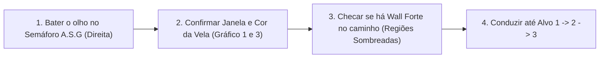

# Manual Técnico e Operacional — Cockpit Fluxo Real + A.S.G + Radar Pro (`WIN` & `WDO`)

Este documento descreve de ponta a ponta o funcionamento visual, matemático e operacional do novo painel principal **`⚡ 1. COCKPIT FLUXO REAL & A.S.G`**, implementado em [`IntradayCompassPanel.jsx`](file:///c:/Users/ryzen/Downloads/Antigravity/wdo%20win%20pair%20trading/regime-dashboard/src/components/IntradayCompassPanel.jsx) e alimentado pelos motores [`core/profit_mt5_flow_engine.py`](file:///c:/Users/ryzen/Downloads/Antigravity/wdo%20win%20pair%20trading/core/profit_mt5_flow_engine.py) e [`core/gex_live_dealer_engine.py`](file:///c:/Users/ryzen/Downloads/Antigravity/wdo%20win%20pair%20trading/core/gex_live_dealer_engine.py).

---

## 1. Visão Geral e Filosofia do Painel

O painel foi desenhado para eliminar o excesso de tabelas e permitir **leitura em 3 segundos**:

A tela é dividida em **3 blocos integrados**:
1. **Barra Superior de Controle**: Seleção instantânea do ativo (`WIN`, `WDO` ou `Visão Dupla`) e seleção do pregão (`🟢 HOJE (AO VIVO)`, `⏪ ONTEM` ou qualquer pregão histórico salvo).
2. **Coluna Esquerda (68% da tela) — Gráfico Triplo Sincronizado (`FluxoRealAsgChart`)**:
   - **Andar 1**: Candles de Preço M5 pintados pelo fluxo + todas as `Wall`s e `MidWall`s do dia + Regiões de Compra/Venda diferenciadas por lote institucional e hedge dos Makers.
   - **Andar 2**: Curva de Fluxo Institucional (`Smart Money CVD`) em pontinhos com graduação de cor por peso do lote.
   - **Andar 3**: Histograma Linha Zero (`Janelas de Fluxo`) com linhas verticais douradas marcando cada virada de janela.
   - **Rodapé**: Barra de dominância `COMPRADORES %` vs `VENDEDORES %`.
3. **Coluna Direita (32% da tela) — HUD A.S.G (`AsgCockpitHud`) + Curva de Capital (`DailyOperationsEquityChart`)**:
   - **Topo**: Semáforo Gigante (`COMPRAR` / `VENDER` / `NEUTRALIZADO`), Vela 3D de contexto (`MICRO`, `MACRO`, `MAKERS GEX`), Escada de Alvos (`ALVO 1`, `ALVO 2`, `ALVO 3`) e Placar de Assertividade.
   - **Base**: Gráfico da Curva de Capital acumulada das operações do dia (em R\$ e pontos).

---

## 2. Barra Superior: Seletor de Ativo e Seletor de Pregão (Hoje / Ontem / Histórico)

Na faixa superior do Cockpit ([`IntradayCompassPanel.jsx`](file:///c:/Users/ryzen/Downloads/Antigravity/wdo%20win%20pair%20trading/regime-dashboard/src/components/IntradayCompassPanel.jsx#L1680-L1760)):

- **Cartões `🇧🇷 ÍNDICE · WINZ26` e `💵 DÓLAR · WDOX26`**:
  - Mostram a cotação atual, a `VWAP` do dia e um **mini-semáforo ao vivo** (`▲ COMPRAR`, `▼ VENDER` ou `❖ NEUTRO`) para você acompanhar os dois ativos mesmo enquanto visualiza apenas um no gráfico.
  - O botão **`⚖️ Ver WIN + WDO Juntos`** empilha os dois Cockpits completos na mesma tela.
- **Seletor `📅 PREGÃO: 🟢 HOJE | ⏪ ONTEM | Histórico`**:
  - **`🟢 HOJE`**: exibe o pregão atual em tempo real (atualizado a cada segundo via MT5 + Profit RTD/CSV).
  - **`⏪ ONTEM`** (e menu de datas anteriores): aciona [`get_historical_session`](file:///c:/Users/ryzen/Downloads/Antigravity/wdo%20win%20pair%20trading/core/profit_mt5_flow_engine.py#L1347-L1479), que reconstrói todas as 114 barras M5 das `09:00` às `18:30`, carrega as 34 `Wall`/`MidWall` exatas daquela data a partir de `jumba_gex_win_history.csv` / `jumba_gex_wdo_history.csv` e recalcula todas as janelas, sinais e a curva de capital daquele dia.

---

## 3. Coluna Esquerda: Gráfico Triplo Sincronizado (`FluxoRealAsgChart`)

Todos os 3 andares compartilham exatamente o mesmo eixo de tempo (`09:00` até o horário atual) e o mesmo cursor vertical (`crosshair`).

### 3.1. Andar 1 — Preço M5 + Walls & MidWalls + Regiões de Compra e Venda

#### A) Cores das Velas de Preço (Pintura por Fluxo)
Cada candle de 5 minutos é colorido pelo estado da janela e da agressão institucional ([`core/gex_live_dealer_engine.py`](file:///c:/Users/ryzen/Downloads/Antigravity/wdo%20win%20pair%20trading/core/gex_live_dealer_engine.py#L863-L868)):
- 🟩 **Vela Verde (`#00e87a`)**: Mercado dentro de **Janela de Compra** com fluxo institucional comprador ativo.
- 🟥 **Vela Vermelha (`#ff3860`)**: Mercado dentro de **Janela de Venda** com fluxo institucional vendedor ativo.
- ⬜ **Vela Cinza (`#9fb0c2`)**: **Pullback / Respiro** (o preço fez uma barra contra a janela ativa, mas sem força suficiente para virar a janela no histograma).
  - *Regra prática*: Velas cinzas dentro de uma janela verde ou vermelha indicam descanso do preço (oportunidade de entrada a favor da janela quando voltar a pintar verde/vermelho).

#### B) Marcações de `Wall` e `MidWall` no Fundo do Gráfico
O gráfico carrega **todas as 34 níveis de GEX do dia** (`payload.all_walls`) e plota todas as linhas que estiverem dentro da escala visível de preço (`[minP, maxP]`):
- **`Wall` (Linha Contínua)**: Strike principal de opções onde há concentração de Gamma dos Market Makers.
- **`MidWall` (Linha Tracejada)**: Ponto médio exato (50%) entre duas `Wall`s principais.
- **Cor por Polaridade Dinâmica**:
  - Todas as linhas **acima** do preço atual ficam **vermelhas** (funcionam como teto/resistência).
  - Todas as linhas **abaixo** do preço atual ficam **verdes** (funcionam como piso/suporte).
  - Se o preço rompe um suporte verde para baixo, ele **inverte a polaridade** e passa a ser pintado de vermelho (vira resistência no pullback).

#### C) Diferenciação Especial das Regiões de Compra e Venda (Lotes de Defesa + Hedge Makers)
Para não marcar todas as `Wall`s do mesmo jeito, cada `Wall` recebe um **Score de Potência (`wall_power_pct` de 0 a 100%)** em [`analyze_asset`](file:///c:/Users/ryzen/Downloads/Antigravity/wdo%20win%20pair%20trading/core/gex_live_dealer_engine.py#L360-L408) combinando dois dados reais:
1. **`Defesa Inst` (`defense_lots` — peso 55%)**: Volume real de lotes institucionais (`≥ 50` contratos no WIN / `≥ 20` no WDO) que agrediram ou absorveram exatamente na faixa daquela `Wall` durante o pregão.
2. **`Hedge Makers` (`maker_hedge_lots` — peso 45%)**: Quantidade estimada de contratos futuros que os Market Makers (Dealers) precisam comprar/vender naquela parede pelo modelo Black-76.

Com base nisso, o gráfico diferencia as paredes em **3 categorias visuais** ([`IntradayCompassPanel.jsx`](file:///c:/Users/ryzen/Downloads/Antigravity/wdo%20win%20pair%20trading/regime-dashboard/src/components/IntradayCompassPanel.jsx#L250-L398)):

| Categoria | Critério | Visual no Gráfico | Exemplo de Rótulo na Faixa |
| :--- | :--- | :--- | :--- |
| **1. `FORTE` (`★`)** | `wall_power_pct >= 35%` ou defesa institucional massiva | Faixa sombreada **larga e intensa**, barra vertical lateral de `4.5px`, linha grossa (`2.0px`) e estrela `★` no preço à direita | `🔥 REGIÃO DE VENDA FORTE · Defesa Inst: 311.702L \| Hedge Makers: 1.575L` |
| **2. `MODERADA`** | `wall_power_pct` entre `23%` e `34%` (ou parede imediata ativa) | Faixa sombreada **intermediária/translúcida** e linha média (`1.2px`) | `Região de Venda · Defesa Inst: 53.093L \| Hedge Makers: 1.575L` |
| **3. `FRACA`** | `wall_power_pct < 23%` (pouco lote institucional / ainda não testada) | **Sem caixa sombreada** (apenas a linha discreta no fundo para não poluir o gráfico) | *(Apenas o preço na escala direita)* |

#### D) Linhas Verticais Douradas e Triângulos de Sinal
- **Linhas Verticais Douradas (`#d4af37`)**: Cruzam os 3 gráficos de cima a baixo no momento exato em que o Histograma (Andar 3) cruza o zero com confirmação e **abre uma nova Janela de Compra ou de Venda**.
- **Triângulos `▲` (Verde) e `▼` (Vermelho)**: Marcam os sinais operacionais disparados quando há defesa/absorção institucional numa `Wall` ou explosão de fluxo institucional a favor dos Dealers. Clicar num triângulo destaca a operação na tabela e na curva de capital.

---

### 3.2. Andar 2 — `2. FLUXO INSTITUCIONAL` (Pontinhos com Graduação de Cor por Peso)

Mostra a trajetória acumulada no dia do **CVD Institucional (`cvd_inst`)**, filtrando apenas negócios de lote grande (`≥ 50` contratos no WIN e `≥ 20` contratos no WDO):
- **Posição vertical (`Y`)**: Saldo acumulado de contratos institucionais desde as `09:00` (exibido à direita, ex.: `-242.073L`).
- **Bolinhas de tamanho fixo (`r = 2.2`) com tonalidade proporcional ao peso do lote na barra** ([`IntradayCompassPanel.jsx`](file:///c:/Users/ryzen/Downloads/Antigravity/wdo%20win%20pair%20trading/regime-dashboard/src/components/IntradayCompassPanel.jsx#L488-L535)):
  - **Fluxo Comprador (Verde)**:
    - Lote leve: Verde claro (`#7bf1a8`)
    - Lote médio (`≥ 1.400L` WIN / `≥ 280L` WDO): Verde vivo (`#00c466`)
    - **Lote pesado institucional (`≥ 3.500L` WIN / `≥ 700L` WDO)**: **Verde escuro profundo (`#007a3d`)**
  - **Fluxo Vendedor (Vermelho)**:
    - Lote leve: Rosa/vermelho claro (`#ff758f`)
    - Lote médio (`≥ 1.400L` WIN / `≥ 280L` WDO): Vermelho vivo (`#e01e45`)
    - **Lote pesado institucional (`≥ 3.500L` WIN / `≥ 700L` WDO)**: **Vermelho escuro/vinho (`#9e0b28`)**
  - **Pullback contra a janela (Cinza)**:
    - Varia de cinza claro (`#b4c3d0`) até **cinza chumbo escuro (`#4a5c6b`)** conforme o peso da barra.

---

### 3.3. Andar 3 — `3. JANELAS DE FLUXO` (Histograma Linha Zero)

É o motor que define se o mercado está em **Janela de Compra** ou **Janela de Venda** ([`core/gex_live_dealer_engine.py`](file:///c:/Users/ryzen/Downloads/Antigravity/wdo%20win%20pair%20trading/core/gex_live_dealer_engine.py#L807-L824)):
- Combina **68% da aceleração do CVD Institucional** (diferença entre a média exponencial rápida de 4 barras e a lenta de 11 barras) + **32% do deslocamento do preço em relação ao canal de volatilidade**.
- **Barras Verdes (acima da linha `ZERO`)**: Pressão compradora dominante.
- **Barras Vermelhas (abaixo da linha `ZERO`)**: Pressão vendedora dominante.
- **Filtro de Histerese (`±6,5`)**: Para evitar falsas viradas em mercado lateral, uma Janela de Compra só vira para Venda quando o histograma cai abaixo de `-6,5` (e vice-versa acima de `+6,5`).

---

### 3.4. Barra Inferior — Dominância `COMPRADORES %` vs `VENDEDORES %`

Localizada no rodapé do gráfico esquerdo, mostra a proporção percentual entre o volume agressor de compra e de venda nos últimos 15 minutos combinada com o fluxo institucional (`buyers_pct` vs `sellers_pct`).

---

## 4. Coluna Direita (Topo): HUD Operacional A.S.G (`AsgCockpitHud`)

Construído pela função [`_build_asg_hud`](file:///c:/Users/ryzen/Downloads/Antigravity/wdo%20win%20pair%20trading/core/gex_live_dealer_engine.py#L914-L1038), resume todo o estado do ativo em **4 blocos visuais**:

### 4.1. Display Superior (`STATUS OPERACIONAL`)
Exibe o comando imediato:
- **🔺 `COMPRAR` (Verde)**: Janela de Compra ativa + fluxo curto alinhado.
- **🔻 `VENDER` (Vermelho)**: Janela de Venda ativa + fluxo curto alinhado.
- **❖ `NEUTRALIZADO` (Azul)**: Acionado automaticamente quando há **conflito** (`is_conflict`):
  1. O histograma perdeu força e está perto de zero (`|flow_hist| < 7,0`); ou
  2. A janela ainda é de Compra, mas o fluxo institucional curto virou muito vendedor (`flow_score < -25`); ou
  3. A janela ainda é de Venda, mas o fluxo institucional curto virou muito comprador (`flow_score > +25`).
  - *Função prática*: Impede que você compre topo ou venda fundo quando o fluxo curto começa a divergir da janela.

### 4.2. Faixa `CONTEXTO` (`AMBIENTE COMPRADO / VENDIDO desde HH:MM`)
Informa qual é o ambiente dominante atual e **desde que horas** aquela janela está aberta (horário da última linha vertical dourada).

### 4.3. Os 3 Medidores ao redor da Vela 3D (`MICRO`, `MACRO` e `MAKERS GEX`)

1. **`MICRO` (Anel circular à esquerda, de `15` a `99`)**:
   - Mede a **força imediata (últimos 5 a 15 minutos)** do fluxo na direção atual:
     $$\text{MICRO} = 35 + 0{,}65 \times \left(0{,}55 \cdot |\text{Histograma}| + 0{,}45 \cdot |\text{FlowScore}_{1m/5m/15m}|\right)$$
   - **Leitura**: Acima de **65** = agressão forte agora; abaixo de **45** = mercado sem força imediata (em respiro/pullback).

2. **`MACRO` (Número no topo da Vela 3D central, de `20` a `98`)**:
   - Mede o **alinhamento da janela atual com a tendência estrutural do dia inteiro** (`CVD Institucional acumulado desde 09:00` + `Preço vs VWAP`).
   - Se a janela atual está **a favor** da tendência do dia (`macro_dir == window_dir`), recebe bônus de **`+15` pontos**; se for um repique **contra** a tendência do dia, recebe penalidade de **`-10` pontos**.
   - **Leitura**: Quando **`MICRO` e `MACRO` estão ambos altos (`> 65`)**, você está operando a favor tanto do fluxo imediato quanto da tendência institucional do dia.

3. **`MAKERS (GEX)` (Caixa à direita, em `%`) + `Médio Janela`**:
   - **`MAKERS (GEX)`**: Mostra a pressão de hedge automático dos Market Makers (`+%` verde = Dealers comprando futuros; `-%` vermelho = Dealers vendendo futuros).
   - **`Médio Janela` (em dourado)**: Preço exato em que a janela atual começou (`window_entry_price`).

### 4.4. Escada de Alvos (`ALVO 1` $\rightarrow$ `ALVO 2` $\rightarrow$ `ALVO 3`)
Lista automaticamente as **3 próximas `Wall` / `MidWall` de GEX** na direção da operação:
- Em **Janela de Compra**: as 3 paredes de resistência acima do preço atual.
- Em **Janela de Venda**: as 3 paredes de suporte abaixo do preço atual.
- O **`ALVO 1`** é destacado em dourado como primeiro ponto de realização parcial ou defesa.

---

## 5. Coluna Direita (Base): Capital das Operações do Dia (`DailyOperationsEquityChart`)

Localizado no canto inferior direito ([`DailyOperationsEquityChart`](file:///c:/Users/ryzen/Downloads/Antigravity/wdo%20win%20pair%20trading/regime-dashboard/src/components/IntradayCompassPanel.jsx#L865-L1110)), plota a evolução financeira acumulada de todos os sinais do dia desde as `09:00`:

- **Seletor de Lote (`1 Contr.`, `5 Contr.`, `10 Contr.` no WIN | `1`, `2`, `5` no WDO)**:
  - Converte automaticamente os pontos acumulados para Reais (`R$ 0,20` por ponto/contrato no WIN; `R$ 10,00` por ponto/contrato no WDO).
- **3 Indicadores Financeiros no Topo**:
  1. **`SALDO ACUMULADO`**: Resultado líquido em `R$` e em `pontos` no dia.
  2. **`FATOR DE LUCRO` (`Profit Factor`)**: Soma dos ganhos dividida pela soma das perdas, junto com o total de operações (`ops`).
  3. **`DRAWDOWN MÁX`**: Maior recuo financeiro sofrido pela curva de capital ao longo do dia.
- **Gráfico Interativo da Curva de Capital**:
  - Cada bolinha na curva representa uma operação do dia (`verde` = gain, `vermelha` = loss). Passar o mouse ou clicar numa bolinha mostra o horário, a direção (`▲ COMPRA` / `▼ VENDA`) e o resultado individual daquele trade.

---

## 6. Passo a Passo Prático: Como Operar Olhando para o Painel

1. **Passo 1 — Olhe para o Semáforo Gigante na Direita (`COMPRAR` / `VENDER` / `NEUTRALIZADO`)**:
   - Se estiver **`NEUTRALIZADO`** (azul), **aguarde** — o mercado está em transição ou conflito de fluxo.
2. **Passo 2 — Cheque `MICRO` e `MACRO` no centro do HUD**:
   - Priorize entradas quando **`MICRO >= 60`** e **`MACRO >= 60`** (fluxo curto alinhado com a estrutura do dia).
3. **Passo 3 — Olhe para o Gráfico 1 (Velas + Regiões Sombreadas)**:
   - Em **Ambiente Vendido (`VENDER`)**: evite vender colado em cima de uma **`🛡️ REGIÃO DE COMPRA FORTE` (verde)**; prefira vender quando o preço fizer pullback (vela cinza que volta a ficar vermelha) abaixo de uma **`🔥 REGIÃO DE VENDA FORTE` (vermelha)**.
   - Em **Ambiente Comprado (`COMPRAR`)**: evite comprar batendo de frente numa **`🔥 REGIÃO DE VENDA FORTE` (vermelha)**; prefira comprar após defesa numa **`🛡️ REGIÃO DE COMPRA FORTE` (verde)** ou no fim de um pullback cinza que volta a pintar vela verde.
4. **Passo 4 — Confirme o Peso Institucional no Gráfico 2 (Pontinhos)**:
   - Bolinhas **verde-escuras** (na compra) ou **vermelho-escuras/vinho** (na venda) confirmam que o lote grande institucional está entrando junto com você.
5. **Passo 5 — Conduza até os Alvos (`ALVO 1` $\rightarrow$ `ALVO 2` $\rightarrow$ `ALVO 3`)**:
   - Utilize o **`ALVO 1`** (dourado) para proteger a operação / realizar parcial e conduza o restante pelos níveis **`ALVO 2`** e **`ALVO 3`** enquanto o histograma (Gráfico 3) mantiver a janela aberta.

