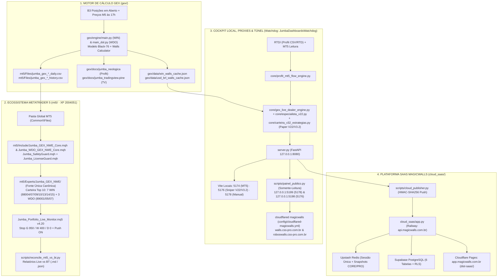

# 🗺️ Mapa Geral e Arquitetura Organizada do Projeto (`WIN` & `WDO`)

Este documento é o **índice central** do repositório (atualizado em **22/11/2026**). Ele organiza claramente **onde encontrar cada arquivo, motor, robô, watchdog e serviço cloud**, dividindo o sistema nas **4 grandes partes operacionais** do projeto:

1. **[Parte 1 — Cálculo Diário de GEX & Exportadores (`gex/`)](#parte-1--cálculo-diário-de-gex--exportadores-gex)**
2. **[Parte 2 — Robôs (EAs) Top 10, Monitor v4.20 & Reconciliação MT5 (`mt5/` + `scripts/reconcile_mt5_vs_bt.py`)](#parte-2--robôs-eas-top-10-monitor-v420--reconciliação-mt5)**
3. **[Parte 3 — Backend Local, Painéis (`5174/5176/5178`), Proxies (`5198/5199`), Túneis Cloudflare & Watchdog](#parte-3--backend-local-painéis-517451765178-proxies-51985199-túneis-cloudflare--watchdog)**
4. **[Parte 4 — Plataforma SaaS MagicWalls (`cloud_saas/` + `scripts/cloud_publisher.py`)](#parte-4--plataforma-saas-magicwalls-cloud_saas--scriptscloud_publisherpy)**

---

## Visão Geral da Arquitetura (Fluxo de Dados Ponta a Ponta)

---

## Parte 1 — Cálculo Diário de GEX & Exportadores (`gex/`)

Responsável por baixar a grade de opções/posições em aberto da B3 e bolsas globais, sincronizar com a cotação das 17h00 no MT5, calcular o **Gamma Exposure (GEX)** via modelo **Black-76**, encontrar o `GammaFlip`, `MaxGamma`, `MinGamma`, as **16 `MagicWalls`** e **`MidWalls`**, e exportar os níveis para o MT5, ProfitChart, TradingView e Dashboard.

### 1.1. Scripts Principais de Cálculo (`gex/engine/`)
| Arquivo | Função |
| :--- | :--- |
| [`gex/engine/main.py`](file:///c:/Users/ryzen/Downloads/Antigravity/wdo%20win%20pair%20trading/gex/engine/main.py) | **Motor GEX do Índice (`WIN` / `IBOV` / `BOVA11`)** — calcula as 16 Walls e MidWalls diárias do WIN. |
| [`gex/engine/main_dol.py`](file:///c:/Users/ryzen/Downloads/Antigravity/wdo%20win%20pair%20trading/gex/engine/main_dol.py) | **Motor GEX do Dólar (`WDO` / `DOL`)** — calcula as 16 Walls e MidWalls diárias do WDO. |
| [`gex/engine/black76.py`](file:///c:/Users/ryzen/Downloads/Antigravity/wdo%20win%20pair%20trading/gex/engine/black76.py) | Precificação Black-76 de opções sobre futuros (cálculo de Volatilidade Implícita, Delta $\Delta$ e Gamma $\Gamma$). |
| [`gex/engine/walls_calculator.py`](file:///c:/Users/ryzen/Downloads/Antigravity/wdo%20win%20pair%20trading/gex/engine/walls_calculator.py) | Algoritmo que identifica os strikes de maior concentração de Gamma (`MagicWalls`), `GammaFlip` e pontos médios (`MidWalls`). |
| [`gex/engine/b3_downloader.py`](file:///c:/Users/ryzen/Downloads/Antigravity/wdo%20win%20pair%20trading/gex/engine/b3_downloader.py) | Download automático dos arquivos de Posições em Aberto da B3 (`Posições em aberto-DD-MM-YYYY.csv`). |
| [`gex/engine/b3_parser.py`](file:///c:/Users/ryzen/Downloads/Antigravity/wdo%20win%20pair%20trading/gex/engine/b3_parser.py) & [`b3_dol_parser.py`](file:///c:/Users/ryzen/Downloads/Antigravity/wdo%20win%20pair%20trading/gex/engine/b3_dol_parser.py) | Leitura e filtragem das séries líquidas de opções de Índice e Dólar na B3. |
| [`gex/engine/mt5_prices.py`](file:///c:/Users/ryzen/Downloads/Antigravity/wdo%20win%20pair%20trading/gex/engine/mt5_prices.py) | Busca no MT5 os preços sincronizados de fechamento/ajuste às **17h00 (M5)** para ancorar a conversão de strikes. |
| [`gex/engine/mt5_exporter.py`](file:///c:/Users/ryzen/Downloads/Antigravity/wdo%20win%20pair%20trading/gex/engine/mt5_exporter.py) | Exporta as Walls calculadas para os arquivos `.csv` e `.json` do MT5 (`mt5/Files/` e `Common\Files`). |
| [`gex/engine/profit_exporter.py`](file:///c:/Users/ryzen/Downloads/Antigravity/wdo%20win%20pair%20trading/gex/engine/profit_exporter.py) | Gera os códigos NTSL atualizados para o ProfitChart (`gex/docs/jumba_neologica`). |
| [`gex/engine/tradingview_exporter.py`](file:///c:/Users/ryzen/Downloads/Antigravity/wdo%20win%20pair%20trading/gex/engine/tradingview_exporter.py) | Gera o script Pine Script v5 atualizado com todas as Walls do dia (`gex/docs/jumba_tradingview.pine`). |
| `gex/engine/main_*.py` (`main_us.py`, `main_nq.py`, `main_gold.py`, `main_btc.py`, etc.) | Motores GEX para ativos internacionais (S&P 500, Nasdaq, Ouro, BTC, DAX, DXY, etc.). |

### 1.2. Caches de Dados e Históricos GEX (`gex/data/`)
| Arquivo | O que armazena |
| :--- | :--- |
| [`gex/data/win_walls_cache.json`](file:///c:/Users/ryzen/Downloads/Antigravity/wdo%20win%20pair%20trading/gex/data/win_walls_cache.json) | Cache oficial das Walls do dia atual para o **WIN** (lido pelo Dashboard em tempo real). |
| [`gex/data/usd_brl_walls_cache.json`](file:///c:/Users/ryzen/Downloads/Antigravity/wdo%20win%20pair%20trading/gex/data/usd_brl_walls_cache.json) | Cache oficial das Walls do dia atual para o **WDO** (lido pelo Dashboard em tempo real). |
| [`gex/data/jumba_gex_win_history.json`](file:///c:/Users/ryzen/Downloads/Antigravity/wdo%20win%20pair%20trading/gex/data/jumba_gex_win_history.json) | Histórico diário de todas as Walls do **WIN** (usado em backtests e no Replay Histórico do Dashboard). |
| [`gex/data/jumba_gex_wdo_history.json`](file:///c:/Users/ryzen/Downloads/Antigravity/wdo%20win%20pair%20trading/gex/data/jumba_gex_wdo_history.json) | Histórico diário de todas as Walls do **WDO** (usado em backtests e no Replay Histórico do Dashboard). |

### 1.3. Indicadores Exportados e Automação Diária
- [`gex/docs/jumba_tradingview.pine`](file:///c:/Users/ryzen/Downloads/Antigravity/wdo%20win%20pair%20trading/gex/docs/jumba_tradingview.pine) — Pine Script das MagicWalls e MidWalls.
- [`gex/docs/jumba_neologica`](file:///c:/Users/ryzen/Downloads/Antigravity/wdo%20win%20pair%20trading/gex/docs/jumba_neologica) & [`MagicWallManual.nts`](file:///c:/Users/ryzen/Downloads/Antigravity/wdo%20win%20pair%20trading/gex/docs/MagicWallManual.nts) — Indicadores NTSL para ProfitChart.
- [`gex/docs/DAILY_REPORT.txt`](file:///c:/Users/ryzen/Downloads/Antigravity/wdo%20win%20pair%20trading/gex/docs/DAILY_REPORT.txt) & [`DAILY_REPORT_DOL.txt`](file:///c:/Users/ryzen/Downloads/Antigravity/wdo%20win%20pair%20trading/gex/docs/DAILY_REPORT_DOL.txt) — Resumo diário de strikes e GammaFlip.
- [`GEX_DAILY.bat`](file:///c:/Users/ryzen/Downloads/Antigravity/wdo%20win%20pair%20trading/GEX_DAILY.bat) / [`GEX_DAILY_ALL.bat`](file:///c:/Users/ryzen/Downloads/Antigravity/wdo%20win%20pair%20trading/GEX_DAILY_ALL.bat) / Skill `/gsd-gex-daily`.

---

## Parte 2 — Robôs (EAs) Top 10, Monitor v4.20 & Reconciliação MT5

Contém a estrutura de execução automatizada no MetaTrader 5 (conta live XP `2004051` e conta de referência `62033102`): bibliotecas `.mqh`, EAs `.mq5`/`.ex5`, perfis, monitor de stop diário e script diário de reconciliação.

### 2.1. Carteira Oficial em Produção — Top 10 (`Campeões + EST-09/10`, desde 19/11/2026)
| Ativo | Robô | Magic | Papel |
| :---: | :--- | :---: | :--- |
| **WIN** | `EST-04` (`Jumba_EST04_Pullback_Reteste_Wall`) | `88004` | Pullback Reteste Wall + BE 2 estágios |
| **WIN** | `EST-07` (`Jumba_EST07_Breakout_Momentum_NY`) | `88007` | Breakout Momentum NY |
| **WIN** | `EST-09` (`Jumba_EST09_Breakout_Stop_Wall`) | `88009` | Breakout Stop & Limit Wall NY (`MaxTr=2/d`, incluído em 19/11/2026) |
| **WIN** | `EST-10` (`Jumba_EST10_Breakout_Stop_Wick`) | `88010` | Breakout MainWalls + GammaFlip (`MaxTr=1/d`, incluído em 19/11/2026) |
| **WIN** | `EST-13` (`Jumba_EST13_SmartGrid_RSI_BE`) | `88013` | SmartGrid RSI + BE 2 estágios |
| **WIN** | `EST-14` (`Jumba_EST14_Grid_Institucional_123L`) | `88014` | Rolling Stop Barra[1] Slope + BE |
| **WIN** | `EST-15` (`Jumba_EST15_Posicional_EOD_Breakout`) | `88015` | Posicional EOD Breakout |
| **WDO** | `WDO-01` (`Jumba_WDO01_Scalper_Hibrido_NY`) | `89001` | Scalper Híbrido NY (WDO<15h) |
| **WDO** | `WDO-05` (`Jumba_WDO05_Cluster_NWE30_NWE50`) | `89005` | Cluster NWE30/NWE50 |
| **WDO** | `WDO-07` (`Jumba_WDO07_Absorcao_Mkt_NY`) | `89007` | Absorção Market NY |

### 2.2. Núcleos, Monitor v4.20 e Fonte Única Canônica (`mt5/`)
| Arquivo | Função Crítica |
| :--- | :--- |
| [`mt5/Include/Jumba_SafetyGuard.mqh`](file:///c:/Users/ryzen/Downloads/Antigravity/wdo%20win%20pair%20trading/mt5/Include/Jumba_SafetyGuard.mqh) | **Trava Rígida de Lote (`JUMBA_FIXED_LOT = 1.0`)**, anti-martingale, anti-loop e leitura das travas diárias `JUMBA_DAILY_STOP_*`. |
| [`mt5/Include/Jumba_LicenseGuard.mqh`](file:///c:/Users/ryzen/Downloads/Antigravity/wdo%20win%20pair%20trading/mt5/Include/Jumba_LicenseGuard.mqh) | Validação de licença (`ACCOUNT_LOGIN` + expiração) via Cloud API para distribuição comercial (Tier QUANT). |
| [`mt5/Include/Jumba_GEX_NWE_Core.mqh`](file:///c:/Users/ryzen/Downloads/Antigravity/wdo%20win%20pair%20trading/mt5/Include/Jumba_GEX_NWE_Core.mqh) | Motor base dos EAs de **WIN** (Walls CSV, NWE, RSI7, entradas/saídas e desenho no gráfico). |
| [`mt5/Include/Jumba_WDO_GEX_NWE_Core.mqh`](file:///c:/Users/ryzen/Downloads/Antigravity/wdo%20win%20pair%20trading/mt5/Include/Jumba_WDO_GEX_NWE_Core.mqh) | Motor base dos EAs de **WDO**. |
| [`mt5/Experts/Jumba_GEX_NWE/`](file:///c:/Users/ryzen/Downloads/Antigravity/wdo%20win%20pair%20trading/mt5/Experts/Jumba_GEX_NWE) | **Fonte única canônica** de todos os EAs `Jumba_*` (`.mq5` e `.ex5`) no repositório (duplicatas `Jumba_*` da raiz `mt5/Experts/` removidas). |
| [`mt5/Experts/Jumba_GEX_NWE/Jumba_Portfolio_Live_Monitor.mq5`](file:///c:/Users/ryzen/Downloads/Antigravity/wdo%20win%20pair%20trading/mt5/Experts/Jumba_GEX_NWE/Jumba_Portfolio_Live_Monitor.mq5) | **Monitor v4.20** dos 10 robôs + **Stop Diário Máximo** (`Global=950.0`, `WIN=400.0`, `WDO=0.0`, `InpSendPushOnStop=true`), exportando CSVs em `Common\Files`. |
| [`mt5/build_and_compile_mt5_eas.py`](file:///c:/Users/ryzen/Downloads/Antigravity/wdo%20win%20pair%20trading/mt5/build_and_compile_mt5_eas.py) | Script de geração/compilação apontando exclusivamente para `mt5/Experts/Jumba_GEX_NWE/` como fonte canônica. |
| [`mt5/Profiles/Charts/Jumba_10_SEM_FILTRO`](file:///c:/Users/ryzen/Downloads/Antigravity/wdo%20win%20pair%20trading/mt5/Profiles/Charts/Jumba_10_SEM_FILTRO) & [`Jumba_8_SEM_FILTRO`](file:///c:/Users/ryzen/Downloads/Antigravity/wdo%20win%20pair%20trading/mt5/Profiles/Charts/Jumba_8_SEM_FILTRO) | Perfis de gráficos M5 pré-configurados para o MT5. |
| [`scripts/reconcile_mt5_vs_bt.py`](file:///c:/Users/ryzen/Downloads/Antigravity/wdo%20win%20pair%20trading/scripts/reconcile_mt5_vs_bt.py) | **Reconciliação diária Live vs Backtest**: lê `Common\Files` (`monitor`, `deals`, `trades_audit`, `daily_stop_state`, `state_*`), compara PnL pro-rata (212d), WR, PF, DD usado%, Loss Streak e gera `.md`/`.json` em `data/reports/reconciliacao_mt5/`. |

---

## Parte 3 — Backend Local, Painéis (`5174/5176/5178`), Proxies (`5198/5199`), Túneis Cloudflare & Watchdog

### 3.1. Arquivos Principais do Cockpit & Supervisão
| Arquivo | Responsabilidade |
| :--- | :--- |
| [`server.py`](file:///c:/Users/ryzen/Downloads/Antigravity/wdo%20win%20pair%20trading/server.py) | Servidor FastAPI local (`http://127.0.0.1:8080`, ~2.935 linhas). Serve rotas `/api/intraday-compass`, `/api/compass/etapa1`, `/api/v2/regime`, `/api/live-calendar`, `/api/gex-walls`, `/health` assíncrono não-bloqueante. |
| [`core/gex_live_dealer_engine.py`](file:///c:/Users/ryzen/Downloads/Antigravity/wdo%20win%20pair%20trading/core/gex_live_dealer_engine.py) | Motor central do cockpit (~4.620 linhas): física GEX (Hedge Makers + Ímã), NWE Causal, Janelas A.S.G, divergências e orquestração paper. |
| [`core/especialista_v22.py`](file:///c:/Users/ryzen/Downloads/Antigravity/wdo%20win%20pair%20trading/core/especialista_v22.py) | Regra única causal do especialista **`ESP_DIV_V22_WIN`** (motor v3.2, 2 contratos WIN no painel `5176`). |
| [`core/carteira_v32_estrategias.py`](file:///c:/Users/ryzen/Downloads/Antigravity/wdo%20win%20pair%20trading/core/carteira_v32_estrategias.py) | **Carteira V3.2** (`C1a_BRK_WIN`, `V1a_DIV_WDO`, `SYM_DIV_WIN`, `SYM_DIV_WDO`) em paper trading no `5176`. |
| [`core/profit_mt5_flow_engine.py`](file:///c:/Users/ryzen/Downloads/Antigravity/wdo%20win%20pair%20trading/core/profit_mt5_flow_engine.py) | Construção das barras M5 de fluxo real (`RTD/` + MT5 leitura + decomposição institucional/varejo). |
| [`core/options_live_radar_engine.py`](file:///c:/Users/ryzen/Downloads/Antigravity/wdo%20win%20pair%20trading/core/options_live_radar_engine.py) | Radar ao vivo de opções `BOVA11` (IV ATM, Skew 25$\Delta$, PCR). |
| [`regime-dashboard/src/components/IntradayCompassPanel.jsx`](file:///c:/Users/ryzen/Downloads/Antigravity/wdo%20win%20pair%20trading/regime-dashboard/src/components/IntradayCompassPanel.jsx) | Interface principal do cockpit para `5174`, `5176`, `5178` e SaaS (`app.magicwalls.com.br`). |
| [`scripts/painel_publico.py`](file:///c:/Users/ryzen/Downloads/Antigravity/wdo%20win%20pair%20trading/scripts/painel_publico.py) | Proxy HTTP **somente-leitura** em `127.0.0.1` servindo `dist-publico/` e filtrando estritamente rotas de leitura (`5199` modo `5178`; `5198` modo `5176`). Bloqueia `/api/restart`, `/api/live-calendar`, `/docs`, etc. |
| [`config/cloudflared-magicwalls.yml`](file:///c:/Users/ryzen/Downloads/Antigravity/wdo%20win%20pair%20trading/config/cloudflared-magicwalls.yml) | Túnel Cloudflare nomeado **`magicwalls`**: `walls.css-pro.com.br` -> `127.0.0.1:5199` e `roboswalls.css-pro.com.br` -> `127.0.0.1:5198`. |
| [`keep_dashboards_alive.py`](file:///c:/Users/ryzen/Downloads/Antigravity/wdo%20win%20pair%20trading/keep_dashboards_alive.py) | **Watchdog Permanente** (tarefa Windows `JumbaDashboardsWatchdog`, substitui o aposentado `ecosystem.config.js`). Supervisiona `8080`, `5174`, `5176`, `5178`, `5198`, `5199`, `cloudflared magicwalls` e `scripts/cloud_publisher.py`, com rotação de logs e carência de startup na `8080`. |

### 3.2. Divisão Oficial de Portas & Painéis
- **`127.0.0.1:8080` (`server.py`):** Backend FastAPI local (nunca exposto direto na LAN/internet).
- **`localhost:5174` (Robôs MT5):** Acompanhamento da carteira automatizada MT5 e `LiveTradingCalendar.jsx`.
- **`localhost:5176` (Sniper Divergência & Carteira V3.2 Paper):** `ESP_DIV_V22_WIN` + 4 estratégias V3.2 (`C1a_BRK_WIN`, `V1a_DIV_WDO`, `SYM_DIV_WIN`, `SYM_DIV_WDO`), Walls e `Fluxo Smart Money`.
- **`localhost:5178` (Gráfico Diário Manual WIN/WDO):** Visão limpa para operação discricionária/manual.
- **`127.0.0.1:5199` / `walls.css-pro.com.br`:** Link público somente-leitura do modo `5178`.
- **`127.0.0.1:5198` / `roboswalls.css-pro.com.br`:** Link público somente-leitura do modo `5176`.

---

## Parte 4 — Plataforma SaaS MagicWalls (`cloud_saas/` + `scripts/cloud_publisher.py`)

Arquitetura Push **Zero-SPOF no PC local**: clientes externos nunca se conectam ao `server.py` local; o produtor local envia snapshots sanitizados para a nuvem, que autentica e distribui em escala.

| Componente / Arquivo | Papel na Arquitetura Cloud |
| :--- | :--- |
| [`scripts/cloud_publisher.py`](file:///c:/Users/ryzen/Downloads/Antigravity/wdo%20win%20pair%20trading/scripts/cloud_publisher.py) | **Produtor Push** (supervisionado por `keep_dashboards_alive.py`): faz 1 leitura em `127.0.0.1:8080`, gera payloads sanitizados `CORE` e `PRO` (com pré-cálculo de divergências V3.2), comprime gzip, assina via HMAC-SHA256 e envia para `api.magicwalls.com.br`. Inclui `HeartbeatMonitor` SLA. |
| [`cloud_saas/app.py`](file:///c:/Users/ryzen/Downloads/Antigravity/wdo%20win%20pair%20trading/cloud_saas/app.py) | **Cloud API FastAPI** (deploy na **Railway** em `https://api.magicwalls.com.br`, [`railway.toml`](file:///c:/Users/ryzen/Downloads/Antigravity/wdo%20win%20pair%20trading/cloud_saas/railway.toml) / [`fly.toml`](file:///c:/Users/ryzen/Downloads/Antigravity/wdo%20win%20pair%20trading/cloud_saas/fly.toml) / [`Dockerfile`](file:///c:/Users/ryzen/Downloads/Antigravity/wdo%20win%20pair%20trading/cloud_saas/Dockerfile)). Valida JWT, sessão única, entitlements por plano e clickwrap LGPD. |
| [`cloud_saas/database.py`](file:///c:/Users/ryzen/Downloads/Antigravity/wdo%20win%20pair%20trading/cloud_saas/database.py) & [`supabase_schema.sql`](file:///c:/Users/ryzen/Downloads/Antigravity/wdo%20win%20pair%20trading/cloud_saas/supabase_schema.sql) | Cliente **Supabase PostgREST** e schema das 6 tabelas com RLS (`profiles`, `subscriptions`, `active_sessions`, `terms_acceptance`, `audit_logs`, `producer_heartbeats`). |
| [`cloud_saas/store.py`](file:///c:/Users/ryzen/Downloads/Antigravity/wdo%20win%20pair%20trading/cloud_saas/store.py) & [`security.py`](file:///c:/Users/ryzen/Downloads/Antigravity/wdo%20win%20pair%20trading/cloud_saas/security.py) | Camada **Upstash Redis REST** (sessão única `401 SESSION_REPLACED` + cache `core`/`pro`) e utilitários de HMAC, PBKDF2, JWT e alertas Telegram/webhook. |
| [`cloud_saas/config.py`](file:///c:/Users/ryzen/Downloads/Antigravity/wdo%20win%20pair%20trading/cloud_saas/config.py) & [`README_DEPLOY.md`](file:///c:/Users/ryzen/Downloads/Antigravity/wdo%20win%20pair%20trading/cloud_saas/README_DEPLOY.md) | Configurações (`MW_*`) e guia completo de deploy (Supabase + Upstash + Railway/Fly + Cloudflare Pages). |
| [`scripts/verify_cloud_connections.py`](file:///c:/Users/ryzen/Downloads/Antigravity/wdo%20win%20pair%20trading/scripts/verify_cloud_connections.py) & [`scripts/criar_usuario_saas.py`](file:///c:/Users/ryzen/Downloads/Antigravity/wdo%20win%20pair%20trading/scripts/criar_usuario_saas.py) | Verificador de conectividade cloud (Supabase + Upstash + Cloud API) e CLI de criação de usuários SaaS. |
| [`regime-dashboard/build-saas.mjs`](file:///c:/Users/ryzen/Downloads/Antigravity/wdo%20win%20pair%20trading/regime-dashboard/build-saas.mjs) | Build estático do frontend SaaS (`dist-saas/`) hospedado no **Cloudflare Pages** (`https://app.magicwalls.com.br`). |

---

## Outros Documentos de Referência na Pasta `docs/`
- [`docs/STOP_DIARIO_11_ROBOS.md`](file:///c:/Users/ryzen/Downloads/Antigravity/wdo%20win%20pair%20trading/docs/STOP_DIARIO_11_ROBOS.md): Política oficial de Stop Diário da carteira Top 10 em produção (`G 950 / W 400 / D 0`) e estudo histórico completo de MAE/Walk-Forward/Monte Carlo.
- [`docs/PLANO_COMERCIAL_SAAS_MAGICWALLS.md`](file:///c:/Users/ryzen/Downloads/Antigravity/wdo%20win%20pair%20trading/docs/PLANO_COMERCIAL_SAAS_MAGICWALLS.md): Plano comercial, escada de planos (`CORE`, `PRO`, `QUANT`), blindagem CVM/LGPD e anti-rateio do SaaS MagicWalls.
- [`docs/PAINEL_5176_SNIPER_DIVERGENCIA_SMART_MONEY.md`](file:///c:/Users/ryzen/Downloads/Antigravity/wdo%20win%20pair%20trading/docs/PAINEL_5176_SNIPER_DIVERGENCIA_SMART_MONEY.md): Especificação e histórico do Painel `5176` (Sniper Divergência na Wall & Fluxo Smart Money).
- [`docs/MANUAL_COCKPIT_FLUXO_REAL_ASG.md`](file:///c:/Users/ryzen/Downloads/Antigravity/wdo%20win%20pair%20trading/docs/MANUAL_COCKPIT_FLUXO_REAL_ASG.md): Manual visual e controles do Cockpit Fluxo Real + GEX.
- [`docs/GUIA_ESTRATEGIAS.md`](file:///c:/Users/ryzen/Downloads/Antigravity/wdo%20win%20pair%20trading/docs/GUIA_ESTRATEGIAS.md) & [`docs/GUIA_OTIMIZACAO.md`](file:///c:/Users/ryzen/Downloads/Antigravity/wdo%20win%20pair%20trading/docs/GUIA_OTIMIZACAO.md): Guias da aba `STAT_ARB` (Kalman / Z-Score WIN×WDO e WIN×DI).
- [`gex/docs/RUNBOOK.md`](file:///c:/Users/ryzen/Downloads/Antigravity/wdo%20win%20pair%20trading/gex/docs/RUNBOOK.md): Runbook operacional de execução diária do pipeline GEX.
