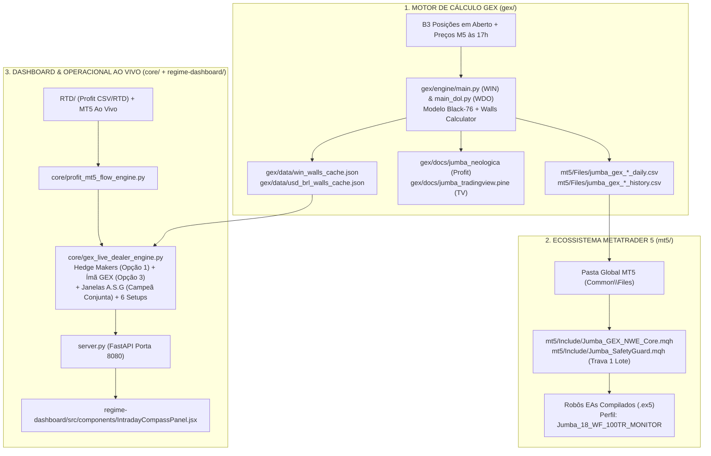

# 🗺️ Mapa Geral e Arquitetura Organizada do Projeto (`WIN` & `WDO`)

Este documento é o **índice central** do repositório. Ele organiza claramente **onde encontrar cada arquivo, motor, robô e painel**, dividindo o sistema nas **3 grandes partes operacionais** do projeto:

1. **[Parte 1 — Cálculo Diário de GEX & Exportadores (`gex/`)](#parte-1--cálculo-diário-de-gex--exportadores-gex)**
2. **[Parte 2 — Arquivos e Robôs (EAs) de Walls no MetaTrader 5 (`mt5/`)](#parte-2--arquivos-e-robôs-eas-de-walls-no-metatrader-5-mt5)**
3. **[Parte 3 — Dashboard Web, Fluxo Real A.S.G e Operacional das 6 Estratégias (`core/` + `regime-dashboard/`)](#parte-3--dashboard-web-fluxo-real-asg-e-operacional-das-6-estratégias)**

---

## Visão Geral da Arquitetura (Fluxo de Dados Ponta a Ponta)

---

## Parte 1 — Cálculo Diário de GEX & Exportadores (`gex/`)

Responsável por baixar a grade de opções/posições em aberto da B3 e bolsas globais, sincronizar com a cotação das 17h00 no MT5, calcular o **Gamma Exposure (GEX)** via modelo **Black-76**, encontrar o `GammaFlip`, `MaxGamma`, `MinGamma`, as **16 `MagicWalls`** e **`MidWalls`**, e exportar os níveis para o MT5, ProfitChart, TradingView e Dashboard.

### 1.1. Scripts Principais de Cálculo (`gex/engine/`)
| Arquivo | Função |
| :--- | :--- |
| [`gex/engine/main.py`](file:///c:/Users/ryzen/Downloads/Antigravity/wdo%20win%20pair%20trading/gex/engine/main.py) | **Motor GEX do Índice (`WIN` / `IBOV` / `BOVA11`)** — calcula as 16 Walls e MidWalls diárias do WIN. |
| [`gex/engine/main_dol.py`](file:///c:/Users/ryzen/Downloads/Antigravity/wdo%20win%20pair%20trading/gex/engine/main_dol.py) | **Motor GEX do Dólar (`WDO` / `DOL`)** — calcula as 16 Walls e MidWalls diárias do WDO. |
| [`gex/engine/black76.py`](file:///c:/Users/ryzen/Downloads/Antigravity/wdo%20win%20pair%20trading/gex/engine/black76.py) | Precificação Black-76 de opções sobre futuros (cálculo de Volatilidade Implícita, Delta $\Delta$ e Gamma $\Gamma$). |
| [`gex/engine/walls_calculator.py`](file:///c:/Users/ryzen/Downloads/Antigravity/wdo%20win%20pair%20trading/gex/engine/walls_calculator.py) | Algoritmo que identifica os strikes de maior concentração de Gamma (`MagicWalls`), `GammaFlip` e pontos médios (`MidWalls`). |
| [`gex/engine/b3_downloader.py`](file:///c:/Users/ryzen/Downloads/Antigravity/wdo%20win%20pair%20trading/gex/engine/b3_downloader.py) | Download automático dos arquivos de Posições em Aberto da B3 (`Posições em aberto-DD-MM-YYYY.csv`). |
| [`gex/engine/b3_parser.py`](file:///c:/Users/ryzen/Downloads/Antigravity/wdo%20win%20pair%20trading/gex/engine/b3_parser.py) & [`b3_dol_parser.py`](file:///c:/Users/ryzen/Downloads/Antigravity/wdo%20win%20pair%20trading/gex/engine/b3_dol_parser.py) | Leitura e filtragem das séries líquidas de opções de Índice e Dólar na B3. |
| [`gex/engine/mt5_prices.py`](file:///c:/Users/ryzen/Downloads/Antigravity/wdo%20win%20pair%20trading/gex/engine/mt5_prices.py) | Busca no MT5 os preços sincronizados de fechamento/ajuste às **17h00 (M5)** para ancorar a conversão de strikes. |
| [`gex/engine/mt5_exporter.py`](file:///c:/Users/ryzen/Downloads/Antigravity/wdo%20win%20pair%20trading/gex/engine/mt5_exporter.py) | Exporta as Walls calculadas para os arquivos `.csv` e `.json` do MT5 (`mt5/Files/` e `Common\Files`). |
| [`gex/engine/profit_exporter.py`](file:///c:/Users/ryzen/Downloads/Antigravity/wdo%20win%20pair%20trading/gex/engine/profit_exporter.py) | Gera os códigos NTSL atualizados para o ProfitChart (`gex/docs/jumba_neologica`). |
| [`gex/engine/tradingview_exporter.py`](file:///c:/Users/ryzen/Downloads/Antigravity/wdo%20win%20pair%20trading/gex/engine/tradingview_exporter.py) | Gera o script Pine Script v5 atualizado com todas as Walls do dia (`gex/docs/jumba_tradingview.pine`). |
| `gex/engine/main_*.py` (`main_us.py`, `main_nq.py`, `main_gold.py`, `main_btc.py`, etc.) | Motores GEX para ativos internacionais (S&P 500, Nasdaq, Ouro, BTC, DAX, DXY, etc.). |

### 1.2. Caches de Dados e Históricos GEX (`gex/data/`)
| Arquivo | O que armazena |
| :--- | :--- |
| [`gex/data/win_walls_cache.json`](file:///c:/Users/ryzen/Downloads/Antigravity/wdo%20win%20pair%20trading/gex/data/win_walls_cache.json) | Cache oficial das Walls do dia atual para o **WIN** (lido pelo Dashboard em tempo real). |
| [`gex/data/usd_brl_walls_cache.json`](file:///c:/Users/ryzen/Downloads/Antigravity/wdo%20win%20pair%20trading/gex/data/usd_brl_walls_cache.json) | Cache oficial das Walls do dia atual para o **WDO** (lido pelo Dashboard em tempo real). |
| [`gex/data/jumba_gex_win_history.json`](file:///c:/Users/ryzen/Downloads/Antigravity/wdo%20win%20pair%20trading/gex/data/jumba_gex_win_history.json) | Histórico diário de todas as Walls do **WIN** (usado em backtests e no Replay Histórico do Dashboard). |
| [`gex/data/jumba_gex_wdo_history.json`](file:///c:/Users/ryzen/Downloads/Antigravity/wdo%20win%20pair%20trading/gex/data/jumba_gex_wdo_history.json) | Histórico diário de todas as Walls do **WDO** (usado em backtests e no Replay Histórico do Dashboard). |

### 1.3. Indicadores Exportados e Relatórios Diários (`gex/docs/`)
| Arquivo | Onde usar |
| :--- | :--- |
| [`gex/docs/jumba_tradingview.pine`](file:///c:/Users/ryzen/Downloads/Antigravity/wdo%20win%20pair%20trading/gex/docs/jumba_tradingview.pine) | Código Pine Script das MagicWalls e MidWalls (também usado como fonte oficial de níveis pelo gráfico do Dashboard). |
| [`gex/docs/jumba_neologica`](file:///c:/Users/ryzen/Downloads/Antigravity/wdo%20win%20pair%20trading/gex/docs/jumba_neologica) & [`MagicWallManual.nts`](file:///c:/Users/ryzen/Downloads/Antigravity/wdo%20win%20pair%20trading/gex/docs/MagicWallManual.nts) | Código do indicador de Walls para colar no Editor de Estratégias do **ProfitChart (Nelogica)**. |
| [`gex/docs/DAILY_REPORT.txt`](file:///c:/Users/ryzen/Downloads/Antigravity/wdo%20win%20pair%20trading/gex/docs/DAILY_REPORT.txt) & [`DAILY_REPORT_DOL.txt`](file:///c:/Users/ryzen/Downloads/Antigravity/wdo%20win%20pair%20trading/gex/docs/DAILY_REPORT_DOL.txt) | Resumo textual diário dos strikes, GammaFlip, MaxGamma e MinGamma de WIN e WDO. |

### 1.4. Automação de Atualização Diária (Raiz do Projeto)
- [`GEX_DAILY.bat`](file:///c:/Users/ryzen/Downloads/Antigravity/wdo%20win%20pair%20trading/GEX_DAILY.bat): Roda o pipeline diário de WIN e WDO.
- [`GEX_DAILY_ALL.bat`](file:///c:/Users/ryzen/Downloads/Antigravity/wdo%20win%20pair%20trading/GEX_DAILY_ALL.bat): Roda WIN, WDO e todos os ativos globais em sequência.
- Skill Antigravity: `/gsd-gex-daily` (automatiza a captura às 17h, cálculo das walls e commit).

---

## Parte 2 — Arquivos e Robôs (EAs) de Walls no MetaTrader 5 (`mt5/`)

Contém toda a estrutura de execução automatizada no MetaTrader 5: bibliotecas `.mqh`, robôs `.mq5`/`.ex5`, indicadores visuais, perfis de gráficos e arquivos de dados de Walls.

### 2.1. Núcleos Compartilhados e Trava de Segurança (`mt5/Include/`)
| Arquivo | Função Crítica |
| :--- | :--- |
| [`mt5/Include/Jumba_SafetyGuard.mqh`](file:///c:/Users/ryzen/Downloads/Antigravity/wdo%20win%20pair%20trading/mt5/Include/Jumba_SafetyGuard.mqh) | **Trava Rígida de Segurança de Lote (`JUMBA_FIXED_LOT = 1.0`)**: Garante que nenhum EA opere mais de **1 mini-contrato**, bloqueia qualquer multiplicador/martingale e impede abertura de nova ordem caso o `MagicNumber` já tenha posição aberta. |
| [`mt5/Include/Jumba_GEX_NWE_Core.mqh`](file:///c:/Users/ryzen/Downloads/Antigravity/wdo%20win%20pair%20trading/mt5/Include/Jumba_GEX_NWE_Core.mqh) | Motor base dos EAs de **WIN**: lê as Walls do CSV, calcula o envelope NWE + RSI7, desenha as linhas no gráfico do MT5 (apenas o EA líder desenha para evitar linhas duplicadas) e gerencia entradas/stops/breakeven. |
| [`mt5/Include/Jumba_WDO_GEX_NWE_Core.mqh`](file:///c:/Users/ryzen/Downloads/Antigravity/wdo%20win%20pair%20trading/mt5/Include/Jumba_WDO_GEX_NWE_Core.mqh) | Motor base dos EAs de **WDO**: equivalente ao Core do WIN, calibrado para a escala de pontos e ticks do Dólar Futuro. |

### 2.2. Arquivos de Walls Lidos pelo MT5 (`mt5/Files/` e `Common\Files`)
Os EAs no MT5 leem automaticamente os arquivos da pasta compartilhada global do Windows (`C:\Users\ryzen\AppData\Roaming\MetaQuotes\Terminal\Common\Files`), cujas cópias-mestre ficam em [`mt5/Files/`](file:///c:/Users/ryzen/Downloads/Antigravity/wdo%20win%20pair%20trading/mt5/Files):
- [`mt5/Files/jumba_gex_win_daily.csv`](file:///c:/Users/ryzen/Downloads/Antigravity/wdo%20win%20pair%20trading/mt5/Files/jumba_gex_win_daily.csv) e [`jumba_gex_win_history.csv`](file:///c:/Users/ryzen/Downloads/Antigravity/wdo%20win%20pair%20trading/mt5/Files/jumba_gex_win_history.csv)
- [`mt5/Files/jumba_gex_wdo_daily.csv`](file:///c:/Users/ryzen/Downloads/Antigravity/wdo%20win%20pair%20trading/mt5/Files/jumba_gex_wdo_daily.csv) e [`jumba_gex_wdo_history.csv`](file:///c:/Users/ryzen/Downloads/Antigravity/wdo%20win%20pair%20trading/mt5/Files/jumba_gex_wdo_history.csv)

### 2.3. Robôs (Expert Advisors) e Perfis do MT5 (`mt5/Experts/` e `mt5/Profiles/`)
- **Pasta de EAs Individuais e Masters:**
  - [`mt5/Experts/`](file:///c:/Users/ryzen/Downloads/Antigravity/wdo%20win%20pair%20trading/mt5/Experts): Contém os EAs individuais de `WIN` (`Jumba_EST01` a `Jumba_EST16`) e `WDO` (`Jumba_WDO01` a `Jumba_WDO16`, `Jumba_WDO_S1` a `S4`), além dos EAs consolidados (`Jumba_Master_*` e `Jumba_WIN_NET_SYNC` / `Jumba_WDO_NET_SYNC`).
  - [`mt5/Experts/Jumba_GEX_NWE/`](file:///c:/Users/ryzen/Downloads/Antigravity/wdo%20win%20pair%20trading/mt5/Experts/Jumba_GEX_NWE): Subpasta sincronizada com `MQL5\Experts\Jumba_GEX_NWE` do terminal MT5 para os perfis de monitoramento.
- **Perfis de Gráficos do MT5 (`mt5/Profiles/Charts/`):**
  - [`mt5/Profiles/Charts/Jumba_18_WF_100TR_MONITOR`](file:///c:/Users/ryzen/Downloads/Antigravity/wdo%20win%20pair%20trading/mt5/Profiles/Charts/Jumba_18_WF_100TR_MONITOR): Perfil com **18 gráficos M5** (10 estratégias WIN + 8 estratégias WDO aprovadas no Walk-Forward), todos configurados com `1 contrato fixo`, `InpDrawWalls` ativo apenas no 1º gráfico de cada ativo (sem linhas dobradas) e caminhos apontando para `Jumba_GEX_NWE\...`.
- **Scripts de Manutenção e Auditoria do MT5 (`mt5/`):**
  - [`mt5/apply_full_ea_audit_fixes.py`](file:///c:/Users/ryzen/Downloads/Antigravity/wdo%20win%20pair%20trading/mt5/apply_full_ea_audit_fixes.py): Audita todos os `.mq5`, injeta o `Jumba_SafetyGuard.mqh`, recompila todos os `.ex5` e copia para o terminal MT5.
  - [`mt5/fix_18_wf_monitor_profile.py`](file:///c:/Users/ryzen/Downloads/Antigravity/wdo%20win%20pair%20trading/mt5/fix_18_wf_monitor_profile.py): Reconstrói e valida os `.chr` dos perfis de 18 gráficos no MT5.

---

## Parte 3 — Dashboard Web, Fluxo Real A.S.G e Operacional das 6 Estratégias

É a central visual de acompanhamento em tempo real e replay histórico na porta `8080`. Combina **Microestrutura do ProfitChart/MT5 (CVD Institucional)** + **Física de Opções (GEX Market Makers)** + **6 Estratégias Sistemáticas**.

### 3.1. Onde Encontrar os Arquivos do Dashboard e Backend
| Arquivo | Responsabilidade |
| :--- | :--- |
| [`server.py`](file:///c:/Users/ryzen/Downloads/Antigravity/wdo%20win%20pair%20trading/server.py) | Servidor FastAPI (porta `8080`). Serve o frontend compilado (`regime-dashboard/dist`) e as rotas `/api/intraday-compass`, `/api/data`, `/api/live`. |
| [`core/gex_live_dealer_engine.py`](file:///c:/Users/ryzen/Downloads/Antigravity/wdo%20win%20pair%20trading/core/gex_live_dealer_engine.py) | **Motor Central do Cockpit**: calcula a física de Hedge dos Market Makers (Opção 1 e Opção 3), a Média NWE Causal, as **Janelas de Fluxo A.S.G (Campeã Conjunta)** e dispara/valida os sinais das **6 Estratégias Oficiais**. |
| [`core/profit_mt5_flow_engine.py`](file:///c:/Users/ryzen/Downloads/Antigravity/wdo%20win%20pair%20trading/core/profit_mt5_flow_engine.py) | Constrói as barras M5 de fluxo real separando **Lote Institucional** (`≥ 50L` WIN / `≥ 20L` WDO) de **Varejo**, lendo em tempo real do MT5 e da pasta `RTD/` e reconstruindo sessões históricas (`get_historical_session`). |
| [`core/options_live_radar_engine.py`](file:///c:/Users/ryzen/Downloads/Antigravity/wdo%20win%20pair%20trading/core/options_live_radar_engine.py) | Radar ao vivo da grade de opções de `BOVA11` (Volatilidade Implícita ATM, Skew 25$\Delta$ Put-Call e PCR). |
| [`regime-dashboard/src/components/IntradayCompassPanel.jsx`](file:///c:/Users/ryzen/Downloads/Antigravity/wdo%20win%20pair%20trading/regime-dashboard/src/components/IntradayCompassPanel.jsx) | **Interface Visual Completa do Cockpit (`5174` Robôs MT5 e `5176` Sniper Divergência Smart Money)**: Gráfico sincronizado (`FluxoRealAsgChart`), Curva de Capital do Dia (`DailyOperationsEquityChart`), Painel de Carteiras Auditadas (`Portfolio4SistematicasPanel`) e Modo Raio-X. |
| [`data/processed/portfolio_4_sistematicas_equity_v1.json`](file:///c:/Users/ryzen/Downloads/Antigravity/wdo%20win%20pair%20trading/data/processed/portfolio_4_sistematicas_equity_v1.json) | Dados consolidados de auditoria histórica (2026) tanto da carteira **Top 8 MT5 (`5174`)** quanto da carteira **Sniper Divergência na Wall (`5176`)** + curvas diárias e mensais. |
| [`research/flow_window_asg/inject_unified_div_opt2.py`](file:///c:/Users/ryzen/Downloads/Antigravity/wdo%20win%20pair%20trading/research/flow_window_asg/inject_unified_div_opt2.py) | Audita os 212 pregões de 2026 e injeta aditivamente a carteira `PORTFOLIO_DIV_OPT2` (`WIN_DIV_WALL` 2c + `WDO_DIV_WALL` 1c) no JSON oficial. |
| [`keep_dashboards_alive.py`](file:///c:/Users/ryzen/Downloads/Antigravity/wdo%20win%20pair%20trading/keep_dashboards_alive.py) | Watchdog residente (`pythonw.exe`) que mantém `8080`, `5174` e `5176` ativos em dual-stack IPv4 + IPv6 (`--host ::`). |

### 3.1.1. Divisão Oficial entre `localhost:5174` e `localhost:5176`
- **`http://localhost:5174` (Robôs MT5 — Proposta A):** Mantém intacta a visão tradicional e o acompanhamento das **8 estratégias M5 automatizadas** (`+R$ 33.046` em 1c, `Ret/DD 28,24x`, `11/11` meses positivos).
- **`http://localhost:5176` (Sniper Divergência na Wall & Fluxo Smart Money):** Painel minimalista que abre por padrão na **`Visão Dupla` (`WIN + WDO` juntos)**, com **Walls brancas/cinzas**, **candles monocromáticos neutros**, sub-painel **`2. FLUXO SMART MONEY`** (apenas linha azul + divergências) e destaque de cor reservado exclusivamente às **divergências `F1➔F2` / `T1➔T2` na Wall** e às **projeções de trade (`TP / SL`)**. Opera o modo base **`2c WIN Mix + 1c WDO MidWall`** (filtro `s/ 12h WIN` e `s/ 11h WDO` + Meta Diária `+R$ 180` / `+R$ 120` ➔ **`+R$ 12.827` líquidos, `WR 70,0%`, `PF 2,49`, `MDD R$ 380`, `Ret/DD 33,76x`, `11/11` meses +**). Documentação completa em [`docs/PAINEL_5176_SNIPER_DIVERGENCIA_SMART_MONEY.md`](file:///c:/Users/ryzen/Downloads/Antigravity/wdo%20win%20pair%20trading/docs/PAINEL_5176_SNIPER_DIVERGENCIA_SMART_MONEY.md).

---

### 3.2. Funcionamento do Gráfico Principal de 4 Andares (`FluxoRealAsgChart`)

O gráfico principal à esquerda possui **4 subpainéis sincronizados** no mesmo eixo de tempo M5:

1. **Andar 1 — Preço M5 + MagicWalls/MidWalls em Branco + Envelope NWE + Caixas de Trade:**
   - Plota as `MagicWalls` (linhas brancas contínuas) e `MidWalls` (linhas cinzas tracejadas) vindas de `jumba_tradingview.pine`, destacando as regiões sombreadas onde há **Defesa Institucional + Hedge dos Makers**.
   - Plota as **3 linhas do Envelope NWE Causal** ($h=8, L=40$, banda $\pm 1{,}8 \times \text{MAE}$), pintadas de **Verde (`↑`)** quando inclinadas para cima e **Vermelho (`↓`)** quando inclinadas para baixo.
   - Plota as **Caixas de Operação estilo TradingView** (Entrada branca, Alvo verde-água, Stop rosa e degrau amarelo de Breakeven).
2. **Andar 2 — `2. FLUXO INSTITUCIONAL CVD` (Lote Grande):**
   - Curva acumulada no dia do saldo de agressão institucional (`cvd_inst`), com bolinhas cuja cor escurece conforme o peso do lote na barra (`Verde escuro` = compra institucional pesada; `Vinho escuro` = venda institucional pesada).
3. **Andar 3 — `3. FLUXO MAKERS GEX` (Alternável no botão do topo entre Opção 1 e Opção 3):**
   - **`📈 GEX: 1. Hedge Acum.` (Opção 1 — Padrão):** Mostra a curva acumulada de contratos futuros que os Market Makers compraram/venderam em hedge desde as 09:00 (`cum_dealer_hedge`).
     - *Bolinhas Verdes/Vermelhas Vivas*: Makers operando **JUNTO com o Institucional (`Squeeze / Aceleração`)** → ideal para setups de rompimento/tendência.
     - *Bolinhas Douradas*: Makers operando **CONTRA o movimento (`Defesa / Absorção na Wall`)** → ideal para setups de rejeição/pullback.
   - **`🧲 GEX: 3. Ímã & Regime` (Opção 3):** Mostra o **Mapa de Atração Gravitacional GEX (`-100%` a `+100%`)**:
     - *Acima de Zero (`+%` Verde)*: O Ímã Dominante das opções está **acima** do preço (puxando para cima).
     - *Abaixo de Zero (`-%` Vermelho)*: O Ímã Dominante das opções está **abaixo** do preço (puxando para baixo).
     - *Zero (`0%`)*: Preço exatamente em cima da MagicWall de equilíbrio, indicando também o regime (`Γ+ Defesa` vs `Γ- Squeeze`).
4. **Andar 4 — `4. JANELAS DE FLUXO A.S.G (Campeã Conjunta · Linha Zero)`:**
   - Histograma suavizado (`-100` a `+100`) que define a **Janela Operacional Ativa** (linhas verticais douradas marcam a abertura de cada janela):
     - **Parâmetros Campeã Conjunta WIN:** `Fast = 5.0`, `Slow = 18.0`, `Peso CVD = 85%`, `Peso Preço = 15%`, `Suavização = 0.45`, `Histerese de Virada = ±11.0`.
     - **Parâmetros Campeã Conjunta WDO:** `Fast = 4.0`, `Slow = 22.0`, `Peso CVD = 85%`, `Peso Preço = 15%`, `Suavização = 0.60`, `Histerese de Virada = ±11.0`.

---

### 3.3. Os 6 Setups Sistemáticos Operados (Todos com 6/6 Meses Positivos)

Todos os 6 setups operam **exclusivamente em barra M5 fechada**, respeitando a **Janela de Fluxo A.S.G (Campeã Conjunta)**:

| Ativo | Código | Nome no Dashboard | Regra de Entrada + Alvo / Stop / Proteção | Resultado Histórico (124 dias · 1 contr.) |
| :---: | :---: | :--- | :--- | :--- |
| **WIN** | `EST_01` | **WIN Rejeição** (`WIN_1`) | Toque/rejeição em `MagicWall`/`MidWall` a favor da Janela A.S.G + pavio $\ge 25\%$ + confirmação do fluxo institucional. **Alvo:** `350 pts` \| **Stop:** `300 pts` \| **BE:** `150p -> +30p`. | **R\$ +4.095** \| PF **1,68** \| MDD **R\$ 249** \| Ret/DD **16,45x** (**6/6 meses +**) |
| **WIN** | `EST_07` | **WIN Rompimento** (`WIN_2`) | Rompimento a favor da Janela A.S.G em **Gamma Negativo** com corpo forte ($\ge 45\%$). **Saída:** na virada da Janela A.S.G (ou máx 24b) \| **Stop:** `300 pts` \| **BE:** `150p -> +30p`. | **R\$ +2.988** \| PF **1,61** \| MDD **R\$ 260** \| Ret/DD **11,49x** (**6/6 meses +**) |
| **WIN** | `EST_13` | **WIN Next Wall** (`WIN_3`) | Entrada na parede testada buscando a **próxima Wall** como alvo estrutural, com **Breakeven na MidWall (50% do caminho)** travando `+20 pts`. | **R\$ +3.353** \| PF **2,90** \| MDD **R\$ 306** \| Ret/DD **10,96x** (**6/6 meses +**) |
| **WDO** | `WDO_09` | **WDO Pullback** (`WDO_1`) | Rejeição/Pullback em `MagicWall`/`MidWall` a favor da Janela A.S.G + fluxo institucional confirmando. **Alvo:** `10,0 pts` \| **Stop:** `10,0 pts` \| **BE:** `3,5p -> +1,0p`. | **R\$ +2.960** \| PF **2,28** \| MDD **R\$ 260** \| Ret/DD **11,38x** (**6/6 meses +**) |
| **WDO** | `WDO_11` | **WDO Next Wall** (`WDO_2`) | Entrada na Wall buscando a **próxima Wall** do dólar, com **Breakeven na MidWall (50% do caminho)** travando `+0,5 pt`. | **R\$ +4.880** \| PF **2,28** \| MDD **R\$ 640** \| Ret/DD **7,62x** (**6/6 meses +**) |
| **WDO** | `WDO_S2` | **WDO Lunch** (`WDO_3`) | Fade/Reversão na janela de almoço (`11h25` às `14h00`) nas extremidades das Walls/NWE a favor da Janela A.S.G. **Saída:** virada da Janela A.S.G \| **Stop:** `10,0 pts` \| **BE:** `3,5p -> +1,0p`. | **R\$ +4.625** \| PF **2,41** \| MDD **R\$ 270** \| Ret/DD **17,13x** (**6/6 meses +**) |
| **TOTAL** | **`PORT_1_1`** | **Carteira 1x WIN + 1x WDO** | Operando os 6 setups simultaneamente com **1 mini-contrato** em cada sinal (**1.103 trades** em 6 meses). | **R\$ +22.901** \| PF **2,04** \| MDD **R\$ 572** \| **Ret/DD = 40,04x** (**6/6 meses +**) |

---

### 3.4. Scripts de Backtest e Otimização da Janela A.S.G e dos 6 Setups (`research/flow_window_asg/`)
| Arquivo | Função |
| :--- | :--- |
| [`research/flow_window_asg/eval_mt5_with_dashboard_filters.py`](file:///c:/Users/ryzen/Downloads/Antigravity/wdo%20win%20pair%20trading/research/flow_window_asg/eval_mt5_with_dashboard_filters.py) | Motor de avaliação histórica dos setups integrando os filtros de Janela de Fluxo A.S.G (`Campeã Conjunta`), CVD Institucional e GEX. |
| [`research/flow_window_asg/generate_portfolio_6_json.py`](file:///c:/Users/ryzen/Downloads/Antigravity/wdo%20win%20pair%20trading/research/flow_window_asg/generate_portfolio_6_json.py) | Gera e salva o arquivo oficial [`data/processed/portfolio_4_sistematicas_equity_v1.json`](file:///c:/Users/ryzen/Downloads/Antigravity/wdo%20win%20pair%20trading/data/processed/portfolio_4_sistematicas_equity_v1.json) com as métricas e curvas de capital dos 6 setups. |
| [`research/flow_window_asg/optimize_flow_window_and_6strats.py`](file:///c:/Users/ryzen/Downloads/Antigravity/wdo%20win%20pair%20trading/research/flow_window_asg/optimize_flow_window_and_6strats.py) | Grid search da Etapa 1 (operação pura da virada de janela A.S.G Stop & Reverse). |
| [`research/flow_window_asg/find_joint_optimal_window.py`](file:///c:/Users/ryzen/Downloads/Antigravity/wdo%20win%20pair%20trading/research/flow_window_asg/find_joint_optimal_window.py) | Otimizador conjunto que encontrou a **Campeã Conjunta** (`6/6 meses positivos` nas 6 estratégias). |

---

## Outros Documentos de Referência na Pasta `docs/`
- [`docs/PAINEL_5176_SNIPER_DIVERGENCIA_SMART_MONEY.md`](file:///c:/Users/ryzen/Downloads/Antigravity/wdo%20win%20pair%20trading/docs/PAINEL_5176_SNIPER_DIVERGENCIA_SMART_MONEY.md): **Manual e especificação oficial do Painel `5176`** (Sniper `F1➔F2 / T1➔T2` na Wall, motor `Fluxo Smart Money`, auditoria 2026 e roadmap de Absorção Filtrada + estratégias `M1`).
- [`docs/MANUAL_COCKPIT_FLUXO_REAL_ASG.md`](file:///c:/Users/ryzen/Downloads/Antigravity/wdo%20win%20pair%20trading/docs/MANUAL_COCKPIT_FLUXO_REAL_ASG.md): Manual detalhado de todos os elementos visuais e controles do Cockpit Fluxo Real + GEX.
- [`docs/GUIA_ESTRATEGIAS.md`](file:///c:/Users/ryzen/Downloads/Antigravity/wdo%20win%20pair%20trading/docs/GUIA_ESTRATEGIAS.md): Guia da aba clássica de Pair Trading (Kalman / Z-Score WIN×WDO e WIN×DI).
- [`docs/GUIA_OTIMIZACAO.md`](file:///c:/Users/ryzen/Downloads/Antigravity/wdo%20win%20pair%20trading/docs/GUIA_OTIMIZACAO.md): Histórico de otimizações da fase Pair Trading.
- [`gex/docs/RUNBOOK.md`](file:///c:/Users/ryzen/Downloads/Antigravity/wdo%20win%20pair%20trading/gex/docs/RUNBOOK.md): Runbook operacional de execução diária do pipeline GEX.

