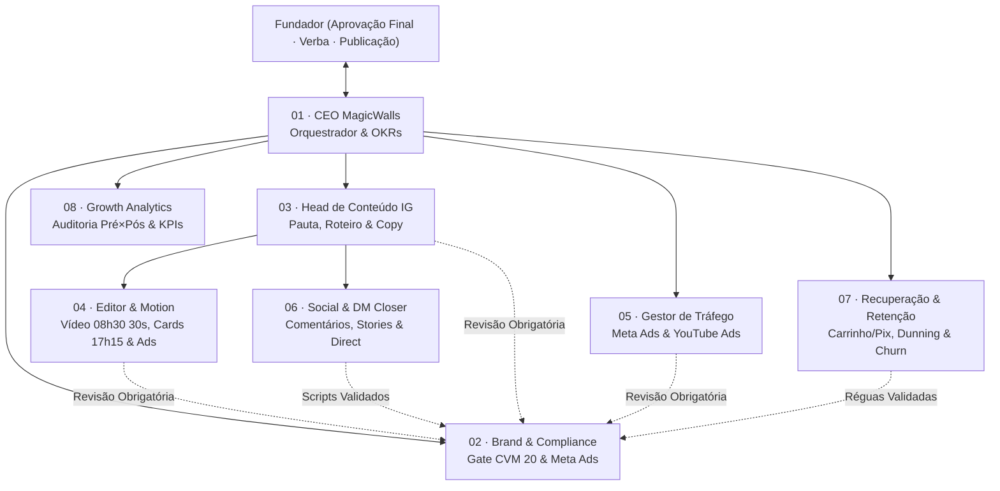

# Equipe de Agentes MagicWalls para OpenBot

Estrutura completa de **8 agentes autônomos coordenados**, **12 skills reutilizáveis** e **5 workflows operacionais** desenhados para rodar no **OpenBot** e transformar o **Instagram** da MagicWalls em uma máquina diária de autoridade verificável, tráfego qualificado, conversão no Direct e retenção de assinantes SaaS.

---

## 1. Organograma da Equipe



### Tabela Resumo dos 8 Agentes

| # | Slug | Cargo / Papel | Reporta a | Foco Principal |
| :-: | :--- | :--- | :--- | :--- |
| **01** | `01-ceo-magicwalls` | **CEO & Orquestrador Geral** | Fundador | Metas de MRR/IG, priorização diária, delegação, resolução de gargalos e resumo executivo. |
| **02** | `02-brand-compliance` | **Gerente de Marca & CVM** | CEO | Gate obrigatório de identidade visual, copy, blindagem CVM 20 e anti-bloqueio Meta Ads. |
| **03** | `03-instagram-content-head` | **Head de Marketing (IG)** | CEO | Calendário editorial Instagram, ganchos de Reels, roteiros de Carrossel, Stories e legendas. |
| **04** | `04-editor-motion` | **Diretor de Edição & Motion** | Content Head | Operação do Estúdio `08h30` (`30s`), `Card IG` (`17h15`), cortes de tela e variações de criativos Ads. |
| **05** | `05-traffic-manager` | **Gestor de Tráfego Pago** | CEO | Meta Ads (IG Reels/Stories/Feed), testes de criativos validados no orgânico, CAC, CPL e ROAS. |
| **06** | `06-social-dm-closer` | **Social Media & DM Closer** | Content Head | Atendimento de comentários e Directs no IG, qualificação (Manual vs PRO vs Quant) e envio de checkout. |
| **07** | `07-recovery-retention` | **Recuperação & Retenção** | CEO | Carrinho abandonado, Pix expirado, dunning (`D-2..D+4`), onboarding `D0–D7`, resgate 5d inativo e Save Offer. |
| **08** | `08-growth-analytics` | **Analista de Dados & Auditoria** | CEO | Auditoria Pré×Pós-Pregão (acerto real das Walls 08:30 vs 17:00) + KPIs de IG, Ads e SaaS. |

---

## 2. Integração com os Ativos Reais do Repositório

Os agentes trabalham **em modo somente-leitura** sobre o repositório principal (`c:\Users\ryzen\Downloads\Antigravity\wdo win pair trading`), consumindo os artefatos reais que o sistema gera todo pregão:

- **Dados Pré-Pregão (`08h00–08h30`):**
  - Endpoint local: `GET http://127.0.0.1:8080/api/morning-brief`
  - Arquivos fonte: `gex/data/win_walls_cache.json`, `gex/data/usd_brl_walls_cache.json`, `gex/docs/DAILY_REPORT.txt`, `gex/docs/DAILY_REPORT_DOL.txt`, `gex/docs/DAILY_ECONOMIC_CALENDAR.txt`.
- **Estúdio de Vídeo Animado 30s (`08h30`):**
  - URL direta: `http://localhost:5176/?mode=morning_video` (implementado em `MorningWallsVideoModal.jsx` + `morningVideoRenderer.js`).
  - Gera vídeo `.mp4`/`.webm` 60fps com áudio, Capa PNG e Legenda CVM-safe com 1 clique.
- **Gerador de Cards de Fechamento (`17h15`):**
  - Botão `📸 Card IG` em `http://localhost:5176/` (`InstagramCardModal.jsx`), exportando Stories `9:16`, Feed `4:5` e Carrossel com horários, pontuações e divergências do dia.

---

## 3. Protocolo de Pastas Compartilhadas no OpenBot (Handoff Seguro)

Seguindo a regra de governança do OpenBot (cada agente grava apenas seus próprios arquivos com timestamp para evitar conflitos), todos os artefatos produzidos pela equipe transitam em `C:\Users\ryzen\OpenBot\Shared\magicwalls\`:

```text
C:\Users\ryzen\OpenBot\Shared\magicwalls\
├── briefs\          # 08-analytics e 03-content gravam pautas e auditorias diárias
├── producao\        # 03-content e 04-editor gravam roteiros, legendas, vídeos e PNGs
├── aprovacao\       # 02-brand-compliance grava pareceres [APROVADO_BRAND] ou [AJUSTAR]
├── publicados\      # Histórico organizado por YYYY-MM-DD dos materiais postados
├── ads\             # 05-traffic grava planos de campanha, criativos campeões e cortes
├── recuperacao\     # 07-recovery grava scripts de régua e relatórios de receita recuperada
└── executive\       # 01-ceo grava delegações do dia e o relatório semanal de sexta-feira
```

**Regra de Nomenclatura Obrigatória:** `YYYY-MM-DD_<workflow_ou_tipo>_<slug-agente>.md` (ex.: `2026-11-23_morning-pack_03-content.md`).

---

## 4. Como Importar e Subir esta Equipe no OpenBot

1. **Verifique o repositório e a Bíblia de Marca:** Leia primeiro [BRAND_BIBLE_CVM.md](file:///c:/Users/ryzen/Downloads/Antigravity/wdo%20win%20pair%20trading/openbot-team/BRAND_BIBLE_CVM.md) e ajuste `@magicwallsb3`, URL final e valores dos planos se desejar.
2. **Crie primeiro o Agente CEO:** Copie o **Prompt 1 (CEO MagicWalls)** de [PROVISIONING_PROMPTS.md](file:///c:/Users/ryzen/Downloads/Antigravity/wdo%20win%20pair%20trading/openbot-team/PROVISIONING_PROMPTS.md) e envie ao seu agente orquestrador no OpenBot.
3. **Crie os 7 Agentes Subordinados:** Use o próprio CEO para provisionar os subordinados a partir dos arquivos em `openbot-team/agents/` ou cole os **Prompts 2 a 8** de [PROVISIONING_PROMPTS.md](file:///c:/Users/ryzen/Downloads/Antigravity/wdo%20win%20pair%20trading/openbot-team/PROVISIONING_PROMPTS.md).
4. **Registre as 12 Skills Locais no OpenBot:** Use o **Prompt 9** para chamar `create_skill` (via `openbot-skill-creator`) apontando para cada subpasta de `openbot-team/skills/` e instale nos agentes correspondentes conforme o [TEAM_MANIFEST.json](file:///c:/Users/ryzen/Downloads/Antigravity/wdo%20win%20pair%20trading/openbot-team/TEAM_MANIFEST.json).
5. **Ative a Rotina Diária do Instagram (`WF-01`):** Agende no OpenBot os gatilhos de `07:50` (Pré-Pregão), `17:10` (Pós-Pregão) e `Sexta 18:00` (Reunião Executiva).

---

## 5. Regras Globais de Segurança e Qualidade

1. **Modo Somente-Leitura no Código:** Nenhum agente desta equipe edita código em `server.py`, `core/`, `gex/` ou `regime-dashboard/`, nem altera bancos (`trades.db`, `regime_watch.db`).
2. **Gate Obrigatório de Compliance (`02-brand-compliance`):** Peça sem carimbo `[APROVADO_BRAND]` não vai para a pasta de aprovação do Fundador.
3. **Separação Fato vs. Relato:** O CEO só pode apresentar ao Fundador métricas, horários de Walls ou resultados como fato após confirmar nos arquivos fonte (`DAILY_REPORT*.txt`, `/api/morning-brief`) ou no relatório auditado do `08-growth-analytics`.
4. **Human-in-the-Loop para Ações Externas:** Postagens no Instagram, alteração de verba/campanhas no Meta Ads e disparos de recuperação em lote são preparados em modo rascunho/pacote pronto e aguardam `[APROVADO_FUNDADOR]`.
