# WF-01 — Rotina Diária do Instagram MagicWalls (`Antes 08:30 × Depois 17:15`)

## 1. Objetivo
Executar todos os dias úteis (pregão B3) o loop diário de prova verificável no Instagram — publicando o **Vídeo Pré-Pregão 30s antes da abertura (08h30)**, alimentando Stories no meio do pregão e fechando com o **Card de Prova Real às 17h15** + atendimento de Directs.

## 2. Gatilho & Agenda (Horário de Brasília · BRT)
- **Turno Manhã (Pré-Pregão):** `07:50 → 08:30 BRT` (Seg–Sex)
- **Turno Intradiário (Stories & DMs):** `10:30 → 15:00 BRT`
- **Turno Fechamento (Prova & Conversão):** `17:05 → 19:00 BRT`

## 3. Agentes Envolvidos
`01-ceo-magicwalls` · `08-growth-analytics` · `03-instagram-content-head` · `04-editor-motion` · `02-brand-compliance` · `06-social-dm-closer` · `07-recovery-retention`

## 4. Fluxo Diário Ponta a Ponta

```mermaid
flowchart LR
    A["07:50 · 08-Analytics<br/>Audita /api/morning-brief"] --> B["08:00 · 03-Content + 04-Editor<br/>Roteiro + Vídeo 30s + Capa PNG"]
    B --> C["08:15 · 02-Brand<br/>Gate CVM 20 & QC"]
    C --> D["08:20 · 01-CEO -> Fundador<br/>Pacote Pronto p/ Postar 08h30"]
    D -.->|"Pregão B3"| E["10:30 · 06-Social<br/>Stories Enquete + DMs"]
    E --> F["17:05 · 08-Analytics<br/>Auditoria Pré × Pós"]
    F --> G["17:15 · 04-Editor + 03-Content<br/>Card IG + Comparativo"]
    G --> H["17:25 · 02-Brand -> 01-CEO<br/>Pacote Fechamento p/ Fundador"]
    H --> I["18:00–19:00 · 06-Social + 07-Recovery<br/>DMs e Recuperação Pix/Link"]
```

### Etapa A — Turno Manhã (`07:50 → 08:25 BRT`)
1. **`07:50` (`08-growth-analytics`):** Consulta `GET http://127.0.0.1:8080/api/morning-brief` e `gex/docs/DAILY_REPORT*.txt`. Valida `ref_date`. Grava `Shared/magicwalls/briefs/YYYY-MM-DD_morning-data_08-analytics.md`.
2. **`08:00` (`03-instagram-content-head` & `04-editor-motion` em paralelo):**
   - `03-content` escreve gancho de 3s + legenda CVM-safe com palavra-chave `"MAPA"` em `producao/YYYY-MM-DD_morning-copy_03-content.md`.
   - `04-editor` abre `http://localhost:5176/morning-video`, confirma badge **`DADOS REAIS`**, exporta Vídeo `9:16` (`30s`) + Capa PNG (`t=8.5s`) em `producao/` com manifesto `YYYY-MM-DD_morning-pack_04-editor.md`.
3. **`08:15` (`02-brand-compliance`):** Roda `mw-brand-cvm-guard` e `mw-video-creative-qc` em até `5 min` e grava `aprovacao/YYYY-MM-DD_morning_02-brand-parecer.md` com `[APROVADO_BRAND]`.
4. **`08:20` (`01-ceo-magicwalls`):** Consolida vídeo, capa e legenda no pacote final (`executive/YYYY-MM-DD_pacote-aprovacao-fundador_01-ceo.md`) para o Fundador postar pontualmente às `08:30` no Reels + Story de compartilhamento.

### Etapa B — Turno Intradiário (`10:30 → 15:00 BRT`)
5. **`10:30` e `14:00` (`06-social-dm-closer`):** Prepara 2–3 frames de Stories (enquete de regime + atualização de reação na Wall + caixa de perguntas) e responde comentários/DMs com meta `< 15 min`.

### Etapa C — Turno Fechamento (`17:05 → 19:00 BRT`)
6. **`17:05` (`08-growth-analytics`):** Audita o dia em `/api/compass/etapa1?lite=1` comparando com o briefing de `07:50` e grava `briefs/YYYY-MM-DD_closing-audit_08-analytics.md`.
7. **`17:15` (`04-editor-motion` + `03-instagram-content-head`):** Exporta `📸 Card IG` (`Stories 9:16` + `Carrossel 2 slides` em `http://localhost:5176/`) pareando com a capa de `08h30`, e escreve legenda de prova transparente (`"Marcado às 08h30 → Reação na sessão"`).
8. **`17:25` (`02-brand-compliance` → `01-ceo-magicwalls`):** Gate CVM 20 em até 5 min → entrega pacote de fechamento ao Fundador até `17:35`.
9. **`18:30` (`06-social-dm-closer` → `07-recovery-retention`):** Repassa leads sem pagamento em `Shared/magicwalls/recuperacao/YYYY-MM-DD_dm-pipeline-handoff_06-social.md`.

## 5. Critérios de Gate
- **Obrigatório:** `[QC_OK]` + `[APROVADO_BRAND]` + `[APROVADO_FUNDADOR]` antes de ir para o ar.

## 6. Plano B (Contingência)
- **Se `/api/morning-brief` estiver com data antiga às 08:05:** `01-ceo-magicwalls` aborta o vídeo `08h30`, aciona o Fundador para checar `GEX_DAILY.bat` e orienta `03-content` a substituir o post matinal por um Reels/Carrossel educacional atemporal do banco de reserva.
- **Se `MediaRecorder` travar na máquina do editor:** Usar a `Capa PNG 08h30` como Story + Post Estático 9:16 com a legenda de níveis para **não perder o carimbo de horário pré-09h**.
