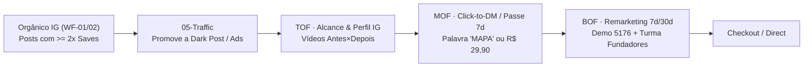

# WF-03 — Tráfego Pago & Esteira de Criativos (Instagram / Meta Ads)

## 1. Objetivo
Transformar os melhores conteúdos orgânicos do Instagram em máquinas pagas de aquisição de leads qualificados, **Passe 7 Dias (`R$ 29,90`)** e assinaturas **CORE / PRO**, mantendo `LTV/CAC >= 4x` e zero bloqueios de conta na Meta.

## 2. Gatilho & Agenda
- **Ciclo de Análise & Otimização:** **Segundas e Quintas às 10:00 BRT** (leitura de 72h).
- **Solicitação de Novos Hooks:** Toda **Quarta-feira às 14:00 BRT**.

## 3. Agentes Envolvidos
`05-traffic-manager` (Líder) · `08-growth-analytics` · `03-instagram-content-head` · `04-editor-motion` · `02-brand-compliance` · `01-ceo-magicwalls`

## 4. Arquitetura de Funil & Fluxo Operacional

### Passo a Passo
1. **Mineração de Vencedores (`Seg 10:00`):** `05-traffic-manager` cruza os dados de `08-growth-analytics` e seleciona os top 2 Reels/Carrosséis orgânicos da semana anterior com maior taxa de salvamento e DMs geradas.
2. **Desdobramento de Ganchos (`Qua 14:00`):** Para cada anúncio ativo com Hook Rate `< 28%` ou frequência `> 2,8`, `05-traffic` envia `ads/YYYY-MM-DD_briefing-criativos_05-traffic.md` ao `03-content` e `04-editor` pedindo **3 variações dos primeiros 3 segundos** mantendo o mesmo corpo validado.
3. **Blindagem Anti-Bloqueio Meta (`Obrigatorio`):**
   - `02-brand-compliance` audita headline, texto principal, legenda do Dark Post, vídeo e página de destino usando `BRAND_BIBLE_CVM.md`.
   - Zero referências a "ganhar dinheiro", "renda extra", "lucro fácil" ou promessa numérica garantida.
4. **Regras Rígidas de Otimização (`Seg/Qui`):**
   - **Pausar:** Hook Rate `< 22%` após 1.000 impressões ou gasto `>= 1,5× CPA alvo` sem compra/DM qualificada.
   - **Escalar:** Conjunto estável há 48–72h dentro do CPA alvo → propor subida máxima de `+20%` no orçamento.
5. **Entrega Executiva:** Gravar plano detalhado em `Shared/magicwalls/ads/YYYY-MM-DD_plano-otimizacao_05-traffic.md` e submeter ao `01-ceo-magicwalls` para aprovação do Fundador.

## 5. Gate & Plano B
- **Gate:** `[APROVADO_BRAND]` obrigatório em todo anúncio + `[APROVADO_FUNDADOR]` antes de apertar publicar ou alterar budget.
- **Plano B (Reprovação / Queda de Entrega):** Ter sempre 2 conjuntos de criativos estritamente analíticos/educacionais (*"Como ler Gamma Flip no Índice e Dólar"*) em reserva para rodar enquanto o novo lote é revisado.
